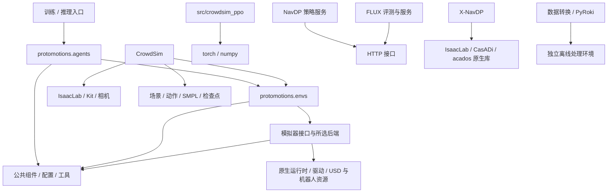

# ProtoMotions 工作区依赖结构审查

审查日期：2026-09-30。基于提交 `7a8417a` 及当前工作区；包含尚未纳入 Git 的 CrowdSim、FLUX、NavDP、src 等目录。依赖与 import 初始快照为 2026-09-29，清单、文件数量和资源存在性于 2026-09-30 复核。本报告分析当前本地项目，不等同于上游发布包审计。

## 1. 结论与范围

这是多个仿真、导航策略、数据处理项目共存的工作区。根 `pyproject.toml` 只管理 ProtoMotions，不能代表所有子项目的安装契约。最需要处理的是安装入口与实际包边界不一致、重复清单约束漂移，以及外部源码、原生库和资源没有形成完整的可复现记录。

已覆盖：934 个 Python 文件的语法解析、6,953 条 import 边、22 个 requirements 文件、根 pyproject 的核心与 extras、Docker/集群安装入口、主要安装文档、默认 CrowdSim 资源。共提取 532 条依赖声明、254 个规范化发行包名、29 个非空声明作用域；不含 build-system 的 `setuptools>=69.5.1`、`wheel`，空 `isaacgym` extra 不计入非空作用域。

没有进行全量依赖安装、完整传递依赖求解、Docker 构建、GPU 仿真或漏洞库审计。因此下文的静态约束冲突是可确认事实；所有未被锁定的传递依赖及实际运行兼容性仍需在目标环境验证。

## 2. 项目结构与依赖边界

```text
ProtoMotions/
├── pyproject.toml                  # 唯一根 Python 包：protomotions
├── requirements_{后端}.txt         # 五个后端环境清单，与 pyproject 存在重复
├── Dockerfile.*                   # 后端、系统库和 CUDA wheel 安装入口
├── protomotions/                  # 351 个 Python 文件，包含测试
│   ├── agents/                    # PPO / AMP 等训练算法
│   ├── envs/                      # 环境与任务
│   ├── simulator/                 # IsaacLab / IsaacGym / MuJoCo / Newton / Genesis
│   ├── components/                # 运动、状态、姿态等公共组件
│   ├── robot_configs/             # 机器人配置
│   ├── utils/                     # 配置、启动、后端导入等
│   └── data/assets/               # MJCF / USD / mesh 等模型资源
├── CrowdSim/                      # 59 个 Python 文件；复用 ProtoMotions 与 IsaacLab
├── src/crowdsim_ppo/               # 7 个 Python 文件；独立 PPO 实现，未被根打包发现
├── FLUX/                          # 201 个 Python 文件；仿真、导航策略、HTTP 服务
├── NavDP/                         # 210 个 Python 文件；含 X-NavDP 与多个 baseline
├── data/                          # 36 个 Python 文件；数据转换与本地数据/权重
├── pyroki/                        # 2 个脚本；依赖外部 PyRoki / JAX 环境
├── deployment/                    # 7 个 Python 文件；部署与推理
├── usd_convert/                   # 5 个 Python 文件；仿真资源转换
├── examples/                      # 47 个 Python 文件；实验与用例
├── tests/                         # 3 个 Python 文件；工作区新增测试
├── scripts/                       # 4 个 Python 文件，另有集群 shell 脚本
└── docs/                          # 文档与审查证据
```



图表示主要依赖方向，不表示各项目必须运行在同一个解释器中，也不表示所有 HTTP 服务直接互通。

### 核心内部耦合

对 225 个非测试核心模块解析出 647 条内部 import 边。排除函数内导入及 `TYPE_CHECKING` 边后，没有检出模块级提前导入的环候选；动态导入、路径注入和后端初始化顺序不在此结论内。

| 模块方向 | 静态 import 边数 | 含义 |
|---|---:|---|
| envs → utils | 35 | 环境依赖公共配置与工具 |
| robot_configs → simulator | 30 | 机器人配置引用模拟器类型/配置 |
| agents → utils | 22 | 训练依赖配置、归一化等工具 |
| simulator → components | 17 | 后端依赖公共状态表示 |
| envs → simulator | 16 | 环境调用模拟器接口 |
| agents → envs | 13 | 算法引用环境接口 |
| simulator → robot_configs | 9 | 与机器人配置层存在反向引用 |
| utils → components / envs | 7 / 6 | utils 并非完全独立的底层 |

粗粒度目录存在双向依赖，不等于具体模块存在循环导入。若进一步拆包，优先提取稳定的状态、配置和协议类型，避免把整个 utils 当作无上层依赖的基础库。

此外，`protomotions/components/pose_lib.py:56` 直接使用 MuJoCo 做运动学处理；MuJoCo 不只属于选中 MuJoCo 仿真后端的环境，核心 `dm-control` 也会传递引入它。

## 3. 环境矩阵

以下是仓库声明/文档目标，不是此次实机认证结果。根包的 `Python>=3.8` 不意味着所有 extra 都支持 3.8。

| 环境 | Python 声明或文档 | 关键依赖 | 安装与隔离边界 |
|---|---|---|---|
| ProtoMotions 核心 | >=3.8 | torch>=2.2；lightning>=2.3,<2.6；tensordict>=0.5,<0.10 | 核心不选择 CUDA wheel 来源 |
| IsaacGym | 3.8 | 外部 IsaacGym Python API；空 isaacgym extra | 手动安装 SDK；独立环境 |
| IsaacLab 主线 | 3.12 / Linux x86_64 | isaaclab==12.0.0；isaacsim==6.0.0.1；torch 2.11 系列；torchvision 0.26 系列 | 先安装文档指定 IsaacLab 源码提交 |
| MuJoCo | 文档 3.10+ | mujoco>=3,<4；tensordict==0.9；openmesh==1.2.1 | 独立后端环境 |
| Newton | 文档 3.10+，推荐 3.11+ | newton==1.0；warp-lang==1.12；mujoco==3.5；mujoco-warp==3.5.0.2 | 含编译、渲染与 GPU 依赖 |
| Genesis | 文档 3.10 | torch==2.5；lightning==2.5.0.post0；genesis-world 未锁定 | 实验性后端；清单不能保证将来相同解析结果 |
| CrowdSim | 跟随其 ProtoMotions / IsaacLab 环境 | 加上 cv2、可选 SMPL mesh 的 smplx、场景与动作资源 | 当前没有独立完整安装清单 |
| crowdsim_ppo | 无独立包元数据 | 静态直接外部 import 为 torch、numpy | 源码存在，但根包不安装它 |
| NavDP 策略服务 | README 3.10 | torch==2.2.2；torchvision==0.17.2；diffusers==0.33.1 | 与仿真环境可按服务进程分离 |
| NavDP 仿真 | README 3.10 | README Sim 4.2 / Lab 1.2；根 requirements Lab 2.0.2 | 文档与清单版本目标不同 |
| FLUX | 推荐镜像提供 | quay.io/zeyinggong/flux:v0 + IsaacLab fork | 镜像 tag 与源码 fork 未构成不可变锁定 |
| X-NavDP | README 3.11 | torch==2.7.0+cu128；vision==0.22.0+cu128；CasADi / acados | 清单注明 Sim 5.0.0.0、Lab 0.46.2、Lab-RL 0.4.0；需独立环境 |
| PyRoki / 重定向 | 文档要求另建环境 | JAX、jaxlie、jaxls、yourdfpy、viser、外部 PyRoki | 不属于核心安装缺包；需记录外部源码 revision |

后端 extras 应按环境选择；不应将所有后端与所有 baseline 的 requirements 合并安装。

## 4. 可操作问题，按影响排序

### D01 — 高：两个 Dockerfile 丢失 Torch 版本约束

位置：`Dockerfile.isaacgym:41`、`Dockerfile.newton:46`。

命令中的 `torch>=2.2` 没有引号。shell 将 `>` 解析为重定向，pip/uv 实际收到 `torch`，并创建名为 `=2.2` 的输出文件。用替代 pip 的 shell 函数已复现，不涉及下载或安装。

影响：最低版本约束没有生效，安装日志也被重定向。并非证明每次都安装错误版本，但构建没有执行文件表面表达的命令。

建议：至少改为 `"torch>=2.2"`；进一步按目标后端固定验证过的版本及 wheel index。

### D02 — 高：X-NavDP 的首次安装步骤未闭合

位置：`NavDP/baselines/x-navdp/requirements.txt:1`、`:2`、`:17`，`README.md:66` 附近。

README 先执行普通 `pip install -r requirements.txt`，文件却要求带 `+cu128` 的 Torch / torchvision，没有声明对应 wheel index；同一步还要求 `acados-template==0.5.1`，而 acados 源码与原生库安装安排在其后。

2026-09-29 查询该 acados-template 精确版本的 PyPI JSON 返回 404。此结论只针对查询的默认公共来源，不排除私有源、本地缓存或预装环境。`torch==2.7.0` 的普通版本也不满足带精确本地版本标记的 `==2.7.0+cu128`。

PyTorch 官方为 2.7.0 的 CUDA 12.8 提供专用 index；acados 官方要求构建共享库并从源码安装 Python interface，运行还涉及共享库搜索路径和代码生成工具。[PyTorch 安装命令](https://pytorch.org/get-started/previous-versions/)、[acados Python interface](https://docs.acados.org/python_interface/index.html)。

建议：分为 CUDA wheel、acados 源码/原生库、Python 应用依赖、Isaac 栈四个明确阶段；记录 acados revision、编译参数和库路径。`src/utils/mpc_tracking.py` 的运行时异常提示不能替代安装阶段依赖供应。

### D03 — 高：文档承诺的 crowdsim-ppo 安装入口不存在

位置：`FULL_PIPELINE.md:72`，`pyproject.toml` 的 packages.find、optional-dependencies、scripts。

文档称 `pip install -e ".[test]"` 安装独立的 `crowdsim-ppo`。实际没有 `test` extra，只有 `dev`；根 setuptools 只发现 `protomotions` 命名空间，没有安装 `src/crowdsim_ppo`，也没有对应 console entry point。仓库根目录可运行的模块，不等于已安装发行包包含它。

建议：为轻量 PPO 单独添加包元数据或显式修正根包发现规则，并统一文档命令。更适合保持其 torch/numpy 依赖边界，避免为轻量训练入口强制引入所有仿真后端。

### D04 — 高：根包约束与环境清单漂移，--no-deps 不会校验它们

位置：`pyproject.toml`、`requirements_isaaclab.txt`、`requirements_isaacgym.txt`、`protomotions/train_slurm.py:773`、`scripts/cluster/lepton_train_loop.sh:230`。

| 包 | 根包声明 | IsaacLab requirements |
|---|---|---|
| lightning | >=2.3,<2.6 | 无版本约束 |
| tensordict | >=0.5,<0.10 | >=0.9 |
| wandb | >=0.15,<0.24 | >=0.23 |
| omegaconf | ==2.3.0 | >=2.3 |
| moviepy | >=2,<3，Python>=3.9 | 无版本约束 |

例如 lightning 2.6、tensordict 0.10、wandb 0.24 被清单允许，却被根包拒绝。集群脚本随后用 `pip install -e . --no-deps`，不会纠正这些不一致。

这不是“每次 pip 都会升级”的结论，而是新建环境或依赖变动时存在项目不支持的合法解析结果。建议以一份核心范围声明为来源，每个后端叠加独立 constraints/lock，并把 `pip check` 纳入构建完成检查。

### D05 — 高：同一主流水线的 IsaacLab 版本基线与文档断裂

主安装文档、requirements 注释、运行时检查以 IsaacLab 包版本 12.0.0、Sim 6.0 和提交 `4ecd0b036da19ff6ad2bb4d621f886b63e9f6db8` 为目标；`FULL_PIPELINE.md:55` 则称 Sim 6.0.1 + Lab 3.0 Beta 2。

FULL_PIPELINE 还引用不存在的四个文件：

- `docs/ISAAC_SIM6_LAB3_MIGRATION_ZH.md`
- `constraints_isaaclab3.txt`
- `CrowdSim/tools/check_isaaclab3.py`
- `CrowdSim/tools/validate_isaaclab3.py`

建议确定当前 CrowdSim 流水线实际验证的唯一组合，修正文档、检查命令和约束路径。不同独立子项目可以使用不同 Lab 版本，但同一安装流程必须明确选择。主线 `isaaclab==12.0.0` 按文档来自源码工作区，不能因为 PyPI 未提供该版本就认定其安装设计错误。

### D06 — 中：CrowdSim 的直接运行依赖没有独立声明

`CrowdSim/world/map.py:10`、`planning.py:3`、`sfm.py:5` 在模块加载时使用 cv2；根 pyproject 和 IsaacLab requirements 没有声明 OpenCV。预装 IsaacLab 或镜像可能间接提供它，但项目本身没有建立保证。

默认 `CrowdSim/config/env.yaml` 启用 human_mesh；`CrowdSim/tools/smpl_mesh_visualizer.py:345` 需要 smplx。根清单未声明它，`world/builder.py:254` 附近捕获异常并放弃 mesh overlay，继续运行。此项会影响相机中的人体外观，应作为明确的视觉功能依赖；不能仅以进程未退出判断环境完整。

建议增加 CrowdSim 直接依赖清单和可选 mesh 依赖组；视觉数据采集时要求检查 mesh 初始化结果与模型资源。

### D07 — 中：LoGoPlanner 所需 Pi3 源码没有提供完整获取步骤

两份 `baselines/logoplanner/geometry_model.py:5` 都导入 `Pi3.pi3.models.pi3`。本地 `NavDP/baselines/logoplanner/Pi3` 是空目录，FLUX 对应目录缺失。README 仅链接 Pi3 并列出 plyfile / huggingface_hub / safetensors 安装，无法供应 Pi3 模型源码。

建议显式声明源码获取位置、目标目录、revision 和相关权重；不要将安装三个辅助包描述为完整安装 Pi3。

### D08 — 中：FLUX requirements 依赖预置镜像，不能独立重建完整环境

`FLUX/requirements.txt` 只有 10 条声明，未列出直接使用的 torch、torchvision、scipy、casadi；例如 `FLUX/utils_tasks/tracking_utils.py:15` 使用 casadi。README 明确推荐预装镜像，因此这不证明推荐镜像缺包；证明该 requirements 不是完整环境描述。

建议记录镜像 digest、所挂载 IsaacLab fork 的 commit，并提供镜像内部的环境锁定产物。若支持不用镜像的安装方式，再补完整安装契约。

### D09 — 中：缺少跨 Python、原生库、源码和资源的可复现记录

未发现项目环境的 uv.lock、poetry.lock、Pipfile.lock、conda-lock 或统一 constraints 锁定产物。多数清单混用开放范围和精确 pin，NavDP 根文件有 220 条环境快照式声明，Genesis 的 genesis-world 开放版本，FLUX 使用可变镜像 tag。

建议分别管理直接依赖与每个受支持平台的已解析锁文件，同时记录 CUDA wheel index、源码 revision、镜像 digest、原生库构建信息、资源校验值。不能简单把所有文件合并成一个 freeze。

## 5. 确认存在的同环境约束冲突

这些冲突仅在把对应清单装入同一个解释器时成立。策略 HTTP 服务、不同仿真后端、数据处理工具采用独立环境时可以合理并存。表中是已核对的代表性组合，不是完整传递依赖冲突枚举。

| 组合 | 不可同时满足的直接声明 |
|---|---|
| 根 core ↔ NavDP 根 | moviepy >=2,<3 ↔ ==1.0.3（Python>=3.9） |
| 根 IsaacLab extra ↔ NavDP 根 | isaaclab ==12.0.0 ↔ ==2.0.2（Linux x86_64） |
| 根 IsaacLab extra ↔ NavDP baseline | torch >=2.11,<2.12 ↔ ==2.2.2；vision >=0.26,<0.27 ↔ ==0.17.2（Linux x86_64） |
| FLUX 根 ↔ FLUX NavDP baseline | numpy ==1.26.4 ↔ ==1.26.0 |
| NavDP 根 ↔ NavDP baseline | Flask 3.0.3 ↔ 3.1.1；OpenCV 4.11.0.86 ↔ 4.9.0.80；Pillow 11.0.0 ↔ 11.2.1；Requests 2.31.0 ↔ 2.32.3 |
| X-NavDP ↔ NavDP baseline | torch 2.7.0+cu128 ↔ 2.2.2；vision 0.22.0+cu128 ↔ 0.17.2；另有 Flask、OpenCV、Requests pin 冲突 |
| NavDP baseline ↔ 其 depth_anything requirements | gradio ==5.31.0 ↔ ==4.29.0 |

比较前已规范化包名：`opencv_python` 与 `opencv-python`、`Requests` 与 `requests` 是同一发行包名。平台和 Python markers 不能忽略。

## 6. 易误判的依赖与打包细节

- **间接依赖不是必然缺包。** `pytorch_lightning` 可由 lightning 引入，filelock 可由 torch 引入，tqdm 可由 lightning 引入。项目直接使用时最好显式声明，但不能仅因根清单没有同名项目就判定无法运行。
- **import 名不等于发行名。** cv2 对应 OpenCV 发行包，PIL 对应 Pillow，yaml 对应 PyYAML，skimage 对应 scikit-image，warp 对应 warp-lang；omni、carb、pxr 属于仿真运行时供应范围。
- **TensorDict 0.9 的元数据没有声明 torch>=2.7。** 本次取得的元数据只声明 torch。不能用版本印象制造硬冲突；具体张量 API 兼容性仍需运行测试。[TensorDict 0.9 元数据](https://pypi.org/pypi/tensordict/0.9.0/json)。
- **xformers 通常是可选加速。** 多份 attention 代码使用 try/except 和常规 attention fallback；部分 nested-tensor 路径有额外要求，应按实际功能判断。
- **ONNX export 与 inference 不同。** 后端 extras 声明 onnxruntime，dev extra 已声明 onnx；不应将导出开发环境要求误记为完全漏报。
- **ROS 是独立系统环境。** FLUX 的 rclpy、消息包、cv_bridge、message_filters 应通过目标 ROS 环境供应；不宜直接把 import 名逐个添加到 pip 清单。
- **PyRoki 与 GRAB 转换器有外部源码依赖。** PyRoki 文档明确使用独立环境；GRAB 转换脚本中的 tools.objectmodel 等指向外部工具，不能因为工作区没有同名顶层包就说所有训练入口都不可运行。
- **硬件和其他 baseline 功能独立。** LeRobot、RealSense、Habitat、navarena_server 等应归属具体部署/评测入口，避免变成核心必装项。
- **wheel 与源码工作区不同。** 根 setuptools 只包含 protomotions；MANIFEST 的源码分发内容不等于 wheel 的 import 包。SMPL 相关受限资源还被显式排除，需按文档独立提供。
- **路径注入提高组合成本。** 多个子项目使用 sys.path、工作目录与 configs/src/policy_network 等通用模块名。现有独立进程启动方式可避开部分冲突；合并成一个 Python 进程前应改成明确命名空间，不能假定 import 总能解析到预期项目。

## 7. 非 Python 依赖与当前资源状态

Python resolver 不能验证 GPU 驱动、CUDA ABI、Kit/PhysX、渲染库、acados 原生共享库、模型与场景是否兼容。Docker 的 apt 依赖、源码构建以及文件路径应作为独立层记录。CUDA wheel index 和主机驱动版本也是两项不同信息。

按当前 CrowdSim 默认配置及仓库根目录解析路径，2026-09-30 复核如下：

| 资源 | 配置路径 | 状态 |
|---|---|---|
| 人体策略权重 | data/pretrained_models/masked_mimic/smpl/last.ckpt | 文件存在 |
| 配套推理配置 | data/pretrained_models/masked_mimic/smpl/resolved_configs_inference.pt | 文件存在 |
| 动作数据 | ../Assets/motion/amass_smpl_validation.pt | 缺失 |
| 仓库场景 | ../Assets/Simple_Warehouse/warehouse_multiple_shelves.usd | 缺失 |
| 导航地图 | CrowdSim/maps/newmap.yaml | 文件存在 |
| 地图引用图片 | CrowdSim/maps/World1.png | 文件存在 |
| PPO 推理权重 | output/crowdsim_robot_ppo/latest/robot_ppo_latest.pt | 缺失；可属于未来训练产物 |
| SMPL 目录 | data/smpl | 目录存在，未验证模型内容 |

存在不等于内容可用。本次没有反序列化 checkpoint、验证资源 hash、解析 USD 的全部外部引用或运行 SMPL 模型。动作和场景默认路径应先补齐或修改配置；PPO 产物则应按训练/推理阶段区分，不能作为全新训练的必备输入。

## 8. 建议落地顺序

1. **修正已证实的入口错误。** 引用 Docker Torch 参数；修正 crowdsim-ppo 安装命令与包定义；移除/修复 FULL_PIPELINE 中不存在的检查入口。
2. **明确实际支持的环境。** 先固定主 ProtoMotions + CrowdSim 组合，再分别维护 NavDP 服务、FLUX 镜像、X-NavDP、数据工具环境；保留服务进程边界。
3. **统一依赖来源。** 核心范围只维护一次；后端和功能组独立叠加；CrowdSim 声明直接依赖；把镜像预装项、Pi3/acados 源码获取和构建步骤纳入说明。
4. **生成目标平台锁定记录。** 记录 Python 小版本、CPU/GPU 架构、CUDA wheel 源、完整传递版本、源码 commit 和镜像 digest。不要在未验证时直接把表中差异改成某个统一版本。
5. **按环境设置验收。** 干净环境安装 → pip check → 入口 import smoke → 所需资源检查 → 一个最小推理/训练步骤。GPU/原生后端检查在对应环境执行。
6. **补工作区 CI 覆盖。** 当前主要 CI 面向 protomotions 测试，新增子项目缺少相应的干净安装矩阵；应给轻量 PPO、CrowdSim 依赖检查、策略服务分别设门槛。

## 9. 证据、方法与限制

- [扫描统计](dependency_audit/summary.json)
- [所有依赖声明 CSV](dependency_audit/declarations.csv)
- [所有静态 import 边 CSV](dependency_audit/imports.csv)
- [直接约束冲突 JSON](dependency_audit/conflicts.json)
- [核心内部依赖图数据](dependency_audit/internal_graph.json)
- [各模块外部 import 候选统计](dependency_audit/import_summary.json)
- [查询的 PyPI 元数据快照](dependency_audit/pypi_metadata.json)
- [默认资源存在性](dependency_audit/resources.json)
- [此前代码审查报告](REPOSITORY_REVIEW_ZH.md)

已完成的验证：934 个 Python 文件均可被 AST 解析；对声明名称、范围、markers 作静态比较；对核心 import 图查环；模拟 shell 重定向；检查包发现边界、安装脚本、缺失文档路径、默认资源和选定包的官方元数据。静态比较不等于运行完整 pip resolver。

CSV 的 `external_candidate`、`local_candidate` 是路径启发式分类，未完全解析多层 sys.path、命名空间和所有相对路径。`guarded` 只表示语法上位于 if/try 内，不能证明该 import 可选；`lazy` 也不等于永远不会执行。pyproject 声明的行号记为 0，具体位置通过 source 对应章节定位。空文件或没有 import 的 Python 文件不会在 import CSV 中产生边。

本轮只新增报告及证据文件，未修改业务代码、依赖清单、现有资产或安装环境。工作区原有未跟踪文件与资产修改均保留。
