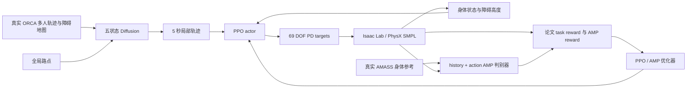

# NavIsaacLab 行人模拟：Diffusion + AMP 实现与训练

## 当前范围

本轮根据论文 IV-A/IV-B 补充了五状态轨迹扩散、PPO/AMP 身体控制、真实 PhysX 训练、多人地图条件数据和独立评估入口，已经进行真实训练。当前环境为 Isaac Sim 6.0.0.1、Isaac Lab 产品版本 3.0.0（Python 包版本 12.0.0）、Python 3.12.13、PyTorch 2.11/CUDA 12.8，GPU 为 RTX 4080 SUPER 16GB。

这些代码和新训练权重属于**公开方法重建**。作者的精确 2,848 条动作清单、完整训练超参数、定制权重及八场景评估协议未取得，因此不能宣称复现了论文中的数值结果。严格作者实验配置会拒绝缺少这些信息的运行。

## 代码结构

| 路径 | 功能 |
|---|---|
| `CrowdSim/humanoid/diffusion/` | `[x,y,vx,vy,yaw]` 五状态 x0 DDPM，temporal U-Net、地图 CNN、自身及邻居历史编码、路点软引导 |
| `CrowdSim/humanoid/amp/` | 公开 PACER 的 SMPL 观测、PD 动作约定与参考权重严格加载 |
| `CrowdSim/humanoid/training/` | PPO、GAE、MLP actor/critic、独立 history+action AMP 判别器、奖励、normalizer 与完整断点恢复 |
| `CrowdSim/humanoid/amass_corpus.py` | 内存映射真实 AMASS，训练/验证/测试隔离，身体参考和单人轨迹窗口 |
| `CrowdSim/humanoid/orca_corpus.py` | 真正 RVO2 多人专家、同步邻居、障碍地图与独立布局划分 |
| `CrowdSim/humanoid/amp_world.py` | 当前 ProtoMotions 的 24 body、69 DOF SMPL，直接 Isaac Lab/PhysX 控制 |
| `CrowdSim/humanoid/reconstruction_scene.py` | 已声明的共享验证场景，统一静态碰撞几何、地图、高度观测及 A* 路点 |
| `CrowdSim/humanoid/evaluation.py` | 15 点姿态、train-only K50/100、Gaussian MMD、重置安全的轨迹统计 |
| `configs/diffusion_amp/` | 方法重建、严格作者实验、参考权重及两种验证场景配置 |



物理频率为 120Hz，控制频率为 30Hz。五状态轨迹在 10Hz 上预测，运行时插值为控制目标。低层直接输出归一化 PD target；手和脚趾冻结坐标在物理动作及判别器输入中均为零。PPO likelihood 保留原始 Gaussian action，避免把截断动作当作原始策略分布。

当前能耗测量在每个 120Hz 子步结束后读取 PhysX `get_dof_projected_joint_forces()`，与同子步结束的关节角速度配对，再对四个子步的有符号功率取平均，单位仍为 W。该 API 测的是沿自由轴投影的关节广义力，不能称为单独分离出的电机力矩；子步平均力与末端速度配对也是明确的离散积分近似。没有测量失败时静默退回代理值的分支。详见 [力矩审计](diffusion_amp_20261001/torque_semantics_audit.md)。

## 实际数据与模型

### AMASS

原处理包位于 `../Assets/motion/amass_smpl_{train,validation,test}.pt`。当前筛选清单位于 `data/diffusion_amp/amass_manifest.json`：319 train、22 validation、34 test，共 375 条有动作名和运动学过滤依据的动作；其中适合 3 秒历史及 5.2 秒未来窗口的数量为 228/20/15。

筛选保持原 split，不把只有数字编号的 CMU 动作猜作走路，不人为凑齐 2,848。9.5GB train 包以 CPU mmap 访问，仅将当前批次送到 GPU。

已额外复核全部 319 train / 22 validation clips，共 2,047 次帧采样：参考骨长与当前 neutral MJCF 的最大误差 0.000503mm，四个 AMP key body 的最大 FK 误差 0.001619mm。当前转换使用统一 neutral 骨架，不应用 AMASS 个体 betas；没有发现骨长不匹配给判别器提供捷径的证据。该检查不等于动态控制相容或收敛，见 [骨架一致性报告](diffusion_amp_20261001/amass_rig_consistency_review.md)。

独立 AMASS 五状态扩散从随机初始化训练了 1,000 次，batch32。验证 normalized x0 MSE 从 1.59768 降至 0.17749，测试 MSE 0.38898。固定权重：

`output/diffusion_amp/diffusion_training/step_1000.ckpt`

SHA256：`4b6f41d0f55146bd12376db1fac0806a4f1b69ae4a12bdb1293e8baada576d7f`。

### 多人地图条件数据

`data/diffusion_amp/orca_social_pilot_v1/manifest.json` 包含真实 RVO2 求解器生成的 24 个独立布局、48 段 episode、44,275 个条件窗口，4–15 人，至少一个障碍物。60Hz 子步检查后再保存同步 10Hz 状态；所有接纳 episode 的穿透均未超过 0.1mm 数值容差。训练/验证/测试的场景布局隔离。

该数据有真实地图与邻居条件，但圆盘朝向采用速度 heading 代理，没有身体关节或真实人类控制命令，因此 AMP 身体参考仍使用 AMASS。

社交条件阶段另行训练了 1,000 次，batch8。最终验证 MSE 0.09420、测试 MSE 0.15961，固定权重：

`output/diffusion_amp/social_diffusion_training/step_1000.ckpt`

SHA256：`69d4336d002c84fa848a93a65dd622e5222a663fac63f61b3e94c6872b8c9d15`。

32 个固定测试窗口的开环 ADE 为 1.063m、FDE 为 2.471m，障碍碰撞点比例仍为 **16.19%**，含障碍碰撞的轨迹比例为 37.50%。该模型已实际训练，但尚不能称为稳定避障模型。详细记录见 [社交扩散训练报告](diffusion_amp_20261001/trace_orca_social_training.md)。

### AMP 身体控制

训练入口为 `scripts/train_paper_amp.py`。首轮实验位于 `output/diffusion_amp/amp_training/`，修正后的独立实验位于 `output/diffusion_amp/amp_training_corrected_power/`：

- `last.pt`：包含 actor/critic、新 AMP 判别器、两组 optimizer、normalizer、RNG、物理及历史/计划状态。
- `metrics.jsonl`：实际 PPO/AMP 损失、梯度、奖励分项、物理交互数、跌倒和超时重置。
- `result.json`：最后一次结束的进程结果；训练期间可能尚未代表最新日志。
- `process_segments/`：已保存的重启检查点。

actor/critic 默认从已校验的公开 PACER no_shape 初始化；新的 history+action 判别器独立随机初始化。`--from-scratch` 支持完全从零训练。公开 PACER 不是论文作者定制权重；原 TRACE 四状态权重也没有装入本轮五状态模型。

进程在 472 次已保存更新处进行了一次有记录的重启，恢复模型、优化器和 RNG，开启无渲染物理模式及显式的推理编译。原 100 步 DDPM、FP32 Tensor、重规划频率、PD 与物理合同保留。编译测试保留全部噪声抽样；其 batch64 XY 最大数值差异为 0.65mm，非 bit-identical。当前 runner 只消费预测 XY。PhysX contact/solver caches 不可序列化，因此物理断点恢复不声称逐 bit 一致。

在 612 次已保存更新处又进行显式的批量规划阶段切换：全局每 15 控制步规划全部行人，新重置行人仍在下一控制前即时规划。最大间隔保持 15 步，即 0.5 秒；刚生成的计划也可能在下一全局 tick 提前刷新。模型、优化器、normalizer、数据、目标与历史状态保留，但局部目标刷新分布和噪声抽样次数/分组会变化；这一阶段及源 checkpoint SHA 写入 provenance，而非伪装成完全相同的采样过程。

原中间 checkpoint 中的 TorchVersion 运行时元数据已在局部、仅针对本项目自产文件的白名单环境中转换为普通字符串。原文件保留，新文件不加白名单即可 `weights_only=True` 加载，全部 120 项 Tensor 与转换前逐项完全相等。后续保存直接使用普通字符串；没有放宽外部权重加载器。

首轮已完成 1,000 次更新、2,048,000 次已保存物理交互，固定权重为 `amp_training/step_1000.pt`，SHA256 `6d71eb71bd596cb235f5195f1ac41794ab653e62ff0fcf9ff488eb23dd5d5d38`，120 项 Tensor 全部有限、默认安全加载通过。但随后审计确认旧 `ImplicitActuator.applied_torque` 是子步前的 PD 估算，旧奖励把它与子步后的速度相乘，存在时间错位。最后更新能耗项贡献了总奖励的 82.38%，这轮结果不能作为正确能耗实现或 AMP 收敛的证据。原权重和日志完整保留。

首轮新权重已实际运行四人共享障碍场景 200 秒，保存 6,000 帧物理状态、400 张渲染图和 MP4：发生 **16 次跌倒重置**，四人路点到达数为 `[0,0,1,0]`，A* 失败 271 次。这证明物理、规划和渲染链路已经执行，但导航和持续稳定性未达标。

修正后的独立训练从公开 PACER 初始化重新启动，新 AMP 判别器与优化器重新初始化，避免继承旧奖励下的策略。已完成 **1,000 次更新、2,048,000 次物理交互**，共 83 次跌倒、6,750 次时限重置。固定权重：

`output/diffusion_amp/amp_training_corrected_power/step_1000.pt`

SHA256：`1d5051cfc36df71b706e4a136458d32539a8084f15c3d1eb9e4dd2b11568213b`，121,308,431 bytes，120 项 Tensor 全部有限，默认 `weights_only=True` 加载通过，unsafe globals 为零。训练时源码快照与 SHA 已冻结。最终 AMP 分项均值 0.25466，轨迹项 0.98174，能耗项 −0.12510；判别器仍明显区分策略与专家，不能称为风格收敛。真实 probe、训练结果及曲线分别见 [物理读数证据](diffusion_amp_20261001/projected_power_physics_probe.json)、[检查点验证](diffusion_amp_20261001/amp_corrected_checkpoint_verification.json)、[新训练曲线](diffusion_amp_20261001/corrected_power_training_analysis/report.md)。

新权重的默认单端点和定时路径方案均已实际验证四人 200 秒。三组实验的完整指标、视频和物理状态均保留：

| 同一验证几何，4 人 × 200 秒 | 旧力矩代理实验 | 新功率测量 / 单端点 | 新功率测量 / 定时 A* |
|---|---:|---:|---:|
| 跌倒重置 | 16 | 16 | 16 |
| 到达路线顶点数 | 1 | 0 | 2 |
| A* 查询失败 | 271 | 68 | 1 |
| 轨迹同刻跟踪均值 m | 0.20594 | 0.21524 | 0.20432 |
| 计划终点到条件目标均值 m | 4.68303 | 5.30737 | 4.64231 |
| 行人 0.3m 圆盘重叠代理 % | 6.2250 | 0.1417 | 6.6833 |
| K50 / K100 姿态覆盖 | 0.72 / 0.54 | 0.84 / 0.67 | 0.90 / 0.78 |
| MMD（本地明确协议） | 0.36388 | 0.33068 | 0.33724 |

每组均有 20 个 observed episodes，其中 16 个发生跌倒，另 4 个在 200 秒截止时尚未结束。立即 reset 将终止状态只保存一帧，不能把 `16/24,000` 当作低跌倒率。真实 PhysX 接触对未采集，圆盘代理不能称为真实碰撞率；当前路由任务和统计分母也不等于作者 Table II。定时方案减少 A* 失败并到达两个顶点，但没有减少跌倒，而且行人重叠代理变差，尚未达到论文表现。

定时方案的 457 次起点恢复都是规划事件，未移动物理 root。该方案是明确的新部署变体，不会追溯改写训练条件或单端点结果。实测轨迹图（已排除 reset 连线）：


真实产物目录：`output/diffusion_amp/shared_obstacle_evaluation_1000/`、`shared_obstacle_corrected_endpoint_1000/`、`shared_obstacle_corrected_timed_1000/`。每组包含 `physical_states.npz`、400 张 PNG、200 秒 MP4 和 `pedestrian_metrics/`；后两组另存 69 DOF 速度、投影广义力及四子步平均功率。完整对照见 [评估比较报告](diffusion_amp_20261001/physical_evaluation_comparison/report.md)。

旧 checkpoint 若要继续旧奖励，必须显式选择 `--power-source legacy_pd_proxy_misaligned`；若迁移到新测量，必须指定 `--new-power-stage`，保存来源 SHA、更新号及前后合同。新实验与新测量下的继续训练不需要该阶段标志。旧训练曲线仍保留在 [training_analysis/report.md](diffusion_amp_20261001/training_analysis/report.md)。

## 运行与继续训练

以下在当前仓库根目录执行。

```bash
source ../IsaacLab-Protomotions/.venv/bin/activate

# 对当前已有清单继续训练；重新开始选择新输出目录
python scripts/train_paper_diffusion.py --steps 1000 --batch-size 32 \
  --output-dir output/diffusion_amp/diffusion_NEW_RUN

# 新社交条件训练阶段，保留已冻结的 AMASS 模型
python scripts/train_orca_diffusion.py --steps 1000 --batch-size 8 \
  --output-dir output/diffusion_amp/social_diffusion_NEW_RUN

# 从头启动新 AMP 实验；缺省使用公开 PACER actor/critic 初始化
TORCHINDUCTOR_COMPILE_THREADS=1 python scripts/train_paper_amp.py \
  --updates 1000 --num-envs 64 --physics-only --compile-diffusion-forward --synchronized-replanning \
  --output output/diffusion_amp/amp_NEW_RUN

# 继续本轮训练：updates 是本次追加更新数
TORCHINDUCTOR_COMPILE_THREADS=1 python scripts/train_paper_amp.py \
  --resume output/diffusion_amp/amp_training_corrected_power/last.pt \
  --updates 1000 --num-envs 64 --physics-only --compile-diffusion-forward --synchronized-replanning \
  --output output/diffusion_amp/amp_training_corrected_power
```

重新生成 AMASS 清单可以运行 `scripts/prepare_diffusion_amp_data.py`。重新生成 ORCA 布局使用已编译 RVO2 的独立环境，选择新输出目录：

```bash
data/tools/orca_generator/.venv/bin/python scripts/generate_orca_diffusion_data.py \
  --output data/diffusion_amp/orca_social_NEW_RUN
```

## 实际多人评估

新增场景使用统一的真实 PhysX cuboid、地图 raster、高度观测和有 0.35m 净空的 A* 路点；它们是本地验证场景，不能替代作者八场景。所有保存的姿势来自关节物理积分，而非播放位置轨迹。

```bash
TORCHINDUCTOR_COMPILE_THREADS=1 python scripts/train_paper_amp.py \
  --resume output/diffusion_amp/amp_training_corrected_power/step_1000.pt --num-envs 4 \
  --evaluate-steps 6000 --episode-steps 6001 --capture \
  --scene-config configs/diffusion_amp/shared_obstacle_validation.yaml \
  --diffusion-checkpoint output/diffusion_amp/social_diffusion_training/step_1000.ckpt \
  --allow-evaluation-planner-change --compile-diffusion-forward --synchronized-replanning \
  --output output/diffusion_amp/shared_obstacle_NEW_EVALUATION

python scripts/evaluate_paper_pedestrians.py \
  --physical-states output/diffusion_amp/shared_obstacle_NEW_EVALUATION/physical_states.npz \
  --output-dir output/diffusion_amp/shared_obstacle_NEW_EVALUATION/pedestrian_metrics

python scripts/summarize_paper_training.py \
  --amp-metrics output/diffusion_amp/amp_training_corrected_power/metrics.jsonl \
  --amp-result output/diffusion_amp/amp_training_corrected_power/result.json \
  --output-dir docs/diffusion_amp_20261001/corrected_power_training_analysis
```

6000 个 30Hz 步为 200 秒。训练绑定 AMASS diffusion 的 SHA 保持不变；部署社交 diffusion 必须显式允许并另存评估身份。平面验证配置为 `shared_flat_validation.yaml`。

定时路径变体将场景换为 `shared_obstacle_timed_validation.yaml` 并指定 `--route-guidance timed_path`，使用新的输出目录。它沿同一 A* 路径提供 0.5、1.0、…、5.0 秒的十个时间提示，总引导权重 10、每点有效权重 1；不读取未来行人的实际轨迹。仅在当前 root 不在真实障碍内的条件下允许 0.5m 内的规划起点恢复；物理 root 不移动，恢复首段不认证完整 clearance。原单端点配置、训练和结果保留。接口边界见 [定时路径说明](diffusion_amp_20261001/route_waypoint_review.md)。

固定真实 heldout 条件的 CPU 引导实验表明：单端点增大到 10/20 会恶化预测，100 会产生非有限坐标；不能靠任意增大权重修复导航。即使提供真实未来十点作为 oracle，指标也只小幅改善，不能推断实际 A* 条件导航会成功，见 [路点引导诊断](diffusion_amp_20261001/waypoint_guidance_review.md)。

评估器记录 train/test 的真实 AMASS 采样 ID、生成帧索引、输入 hash、K50/100 聚类中心和 MMD kernel 参数。生成姿势与 train-only 聚类比较，test 不参与拟合。重置跳跃不计入路径长度或目标进度。root 圆盘/几何重叠仅为碰撞代理；缺少接触对数据时，真实地图/行人碰撞结果仍为 `None`。

## 论文不能唯一确定的部分

默认保存印出的奖励：`r_amp + 0.5*(exp(-2*delta) - 0.0005*sum(torque*velocity) + 1-exp(min(0,u)/1.8))`。方向式在反走时为正，有符号能耗式会奖励负机械功，与论文的文字描述存在差异。代码记录这些分项；`backwards_penalty` 是明确改变印出等式的替代设置。

其余明确的本地选择包括：PPO/MLP 宽度与优化器参数参考公开 PACER；AMP reward 用 `2*softplus(D)`；十帧 newest-first 身体历史；专家 action 为下一帧 mocap 关节位置映射的 PD target 代理；delta 使用当前时刻 root XY 误差；5 秒计划之后的 task observation 保持端点。AMASS 没有实测专家力矩，因此上述 action 不是 inverse dynamics 真值。

完整公式、契约及 CPU 回归范围见 [公开方法规范](diffusion_amp_20261001/paper_method_spec.md)，参考资产与模型身份见 [资源报告](NAVISAACLAB_RESOURCES_AND_REPRODUCTION_20261001_ZH.md)。

## 仍需完成或验证

1. 改善社交 diffusion 的障碍避让与长期多人闭环表现；训练 loss 降低尚不足以证明避障。
2. 改善 AMP 的长期稳定性和全局路径跟随；两轮训练、三组真实 200 秒验证已完成，当前都未达到论文表现。需研究判别器的专家动作代理、动态状态分布及全局路径条件；仅延长训练或提高 guidance weight 不足以保证解决这些问题。
3. 对四个本地 DynBench 场景的 CPU 投影地图做真实 collider/PhysX 复核。两仓库缺失的 KLT 与叉车现已补齐并链接：KLT 来自官方存储，叉车主体来自官方存储，唯一未下载到的法线纹理由三份哈希完全一致的本地原场景包补齐。新的四图位于 `data/diffusion_amp/maps_resource_complete/`，仓库与完整仓库 free cells 分别为 59,521 / 152,956；11,654 条视觉依赖路径记录缺失数为零。实际来源与网络失败记录见 [资源下载结果](maps_projection_asset_download_result.md)，新地图及边界证据见 [完整场景地图报告](maps_projection_resource_complete_inventory.md)。这些 CPU 检查不是 PhysX collider 或 RTX 全场景验收。
4. 作者精确动作清单、八场景/seed/episode/聚合定义、未公开超参数无法从现有论文唯一恢复。自己训练的新权重可以用于方法实验，但不能替代这些信息来宣称作者实验逐项一致。

本轮合并回归记录在 `diffusion_amp_20261001/focused_reconstruction_tests.xml`：当时 120 passed、7 skipped；独立 RVO2 环境的 8 项实际测试已通过。后续 resolver 和 CLI 新增回归分别另存 JUnit/验证 JSON。真实 CUDA 推理、真实训练和物理 rollout 的证据与 CPU 接口夹具分开保存。

本次功率、场景、定时路点及引导诊断的集中回归为 **92 passed**，Ruff 通过，JUnit：`diffusion_amp_20261001/final_power_route_guidance_tests.xml`。不将多轮重叠测试数量相加。
