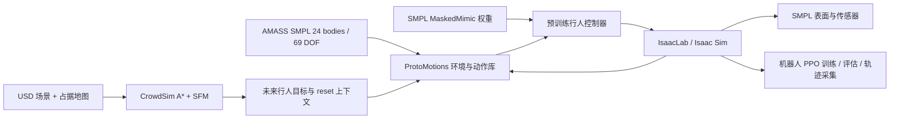

# 全项目依赖、资源、权重与代码审计

> 本文件是修正前审计快照。当前代码及真实 Isaac Sim 行人闭环验收见
> [后续修正报告](PROJECT_COMPLETION_20261001_ZH.md)；下文失败和“尚未运行”的描述不代表最新状态。

> 本文保留迁移前的审计快照，以下“未修复”“未启动 Kit”和测试数量属于当时状态。
> **2026-10-01 后续迁移已完成 SFM+SMPL MaskedMimic 四人8秒物理、蒙皮和视频验收，最终回归1,750项通过。**
> 当前代码、环境、资源和已知限制以 [Isaac Sim6 / IsaacLab3 迁移说明](ISAAC_SIM6_LAB3_MIGRATION_ZH.md) 为准；严格论文仍缺 Diffusion、匹配的 SMPL AMP 与实验定义。

日期：2026-10-01；范围：`/project/EXP/SangforAndSaut/ProtoMotions` 当前工作树及其实际使用的相邻 Assets、IsaacLab 工作区。源码基准提交 `7a8417a`，包含未提交与未跟踪的扩展。**本次纳入 FLUX/NavDP。** 本轮新增审查报告与复现证据，没有修复业务代码或变更运行环境。

## 结论

**当前 AMASS 和 ProtoMotions 行人控制权重已具备，但项目尚未达到可可靠复现 NavIsaacLab 行人闭环、机器人训练与评估的状态。**

主要阻塞是 CrowdSim 的配置迁移入口、四元数读写、子集 reset、评估观测，以及预训练行人模型的推理模式。另有实际 USD 包文件覆盖、缺失场景/外观资源和训练正确性问题。严格复现论文还需要对应的轨迹扩散模型、SMPL AMP 控制器及数据/任务定义；现有 SFM + MaskedMimic 实现不能等同于论文方法。

已完成：23 份依赖声明和实际 270 包环境对照；初始扫描 938 个 Python / 14 个 shell 文件；8 套 ProtoMotions 预训练模型 CPU 严格加载；6 份场景配置的 USD 依赖递归检查；ProtoMotions、CrowdSim、根 tests 合并执行。**测试：1,632 通过、4 失败、2 跳过、4 取消选择。**

本轮没有启动 Isaac Sim Kit 或进行真实行人 rollout。Newton 的一项 CUDA FK 测试实际执行且失败；其余大部分测试为 CPU 或使用替身。全量语法与资源清单检查、关键链路语义审查不等于逐行证明全部实现正确。

## 1. 项目结构与运行关系

```text
ProtoMotions/
├── protomotions/             # 模型、RL/监督学习、动作库、机器人配置与多后端仿真
│   ├── agents/
│   ├── components/           # MotionLib / PoseLib / SceneLib
│   ├── envs/                 # reset、观测、目标、奖励与动作采样
│   ├── simulator/            # IsaacLab / Newton / MuJoCo 等后端与 recording
│   ├── robot_configs/
│   ├── data/assets/          # MJCF/USD 物理模型
│   └── tests/
├── CrowdSim/                 # 本地行人、人群与机器人导航扩展
│   ├── protomotions_runtime.py
│   ├── nav_manager.py        # A* / SFM / 行人目标 / reset hook
│   ├── control/              # 机器人驱动
│   ├── world/                # 构建、地图与规划
│   ├── ppo/                  # 机器人训练/微调
│   ├── flow/                 # 专家轨迹采集
│   ├── pref/                 # 偏好与离线奖励
│   ├── tools/                # 评估、SMPL 蒙皮、渲染与诊断
│   ├── config/               # 场景、训练、采集定义
│   └── maps/, tests/
├── src/crowdsim_ppo/          # 轻量二维 PPO 参考实现；当前未由根包安装
├── FLUX/, NavDP/              # 独立机器人导航基线及部署代码
├── data/pretrained_models/    # 8 套 ProtoMotions 预训练模型与配置
├── data/scripts/              # AMASS 等数据准备
├── examples/, deployment/, usd_convert/, pyroki/, scripts/
├── tests/, configs/           # 扩展测试与轻量参考配置
└── docs/                     # 本次及历史审计、安装与数据准备证据

相邻目录：
├── ../IsaacLab-Protomotions/  # 实际 uv profile、uv.lock、.venv
├── ../Assets/                # AMASS、DynBench、NVIDIA 等本地资源
└── ../arena_sangfor/          # 已发现但未接入的 SMPL 参数模型
```

以下是当前代码的数据流；该调用链仍受后文问题阻塞：



## 2. 优先处理的问题

P1：主要入口阻塞、关键状态/评估错误或凭据传播。P2：条件触发的正确性、资源契约或交付问题。位置均指当前工作树；具体复现、条件与修复方向见专项报告。

### 2.1 P1 发现

| 问题 | 位置 | 已确认的后果或证据 |
|---|---|---|
| 配置迁移导入不存在的函数 | `CrowdSim/protomotions_runtime.py:122,132` | `apply_backward_compatibility_fixes` 在当前 inference_utils 中不存在；恢复配置入口抛 ImportError |
| 机器人/人体仍按 wxyz 处理新后端的 xyzw | `CrowdSim/control/drive.py:149`；`nav_manager.py:2348`；`tools/smpl_mesh_visualizer.py:168` | 单位 xyzw `[0,0,0,1]` 得 yaw=180°；写 yaw=0 得 `[1,0,0,0]`；网格方向反转 |
| 非连续行人 reset 使用错误全局索引 | `CrowdSim/nav_manager.py:899,938,957,2537` | 只 reset 行人 1：目标时间 10.5，预期 20.5；mask=0，预期 1 |
| 评估循环没有更新人体观测/消费 done | `CrowdSim/tools/eval_policy.py:360,371,403` | 丢弃 env.step 的新 obs；旧 obs 为克隆，后续行人策略持续使用初始观测 |
| 冻结行人控制器未切 eval，归一化统计漂移 | `CrowdSim/protomotions_runtime.py`；训练、微调、采集与评估入口 | no_grad 不阻止 NormObsBase 在 training 下更新统计；真实 CPU 归一化均值 0→0.01，eval 后不再更新。主展示 crowd_sim.py 已调用 eval，需区分入口 |
| 专家轨迹采集 main 三个变量未定义 | `CrowdSim/flow/collect_ppo_buffer.py:861–863` | `repeat_robot_routes`、`target_episodes`、`route_repeats` 没有赋值，执行到调用处 NameError |
| 两个 USD 包覆盖同一二进制 | `../IsaacLab-Protomotions/pyproject.toml:63,66`；实际 `.venv` | usd-core 25.11 / usd-exchange 3.0.0 均拥有 `_usd.so`；实际 hash 属于后者，隔离导入 USD=26.8。pip check/锁 dry-run 未发现文件覆盖；未验证 Kit 是否失败 |
| FLUX 部署接口图像维度错误 | `FLUX/baselines/flux/deployment_server.py:132,136,144` | 宽高错误 reshape；4 维深度按 5 维索引。模型替身成功返回后实际处理函数仍返回 HTTP 500 |
| NavDP 模拟入口仍用旧 IsaacLab 命名空间 | `NavDP/eval_pointgoal_wheeled.py:2` 及其他 eval/teleop | 新环境实际导入 omni.isaac.lab.app 失败；isaaclab.app 导入成功。旧 envs/managers/wrapper 路径也需迁移 |
| FLUX 三个仿真评估入口指定不存在的 Sim 4.5 experience | `FLUX/eval_pointgoal_wheeled.py:52`；nogoal/imagegoal `:27` | 本机无指定绝对文件；当前 AppLauncher 在路径校验处抛 FileNotFoundError，早于 SimulationApp 构建；本轮未构造 launcher |
| SMPL tracker 默认使用 G1 动作库（条件） | `data/pretrained_models/motion_tracker/smpl/resolved_configs_inference.yaml:1579` 及 smpl-terrains；实际 inference.pt 同样确认 | 实际动作 33 bodies / 29 DOF，SMPL 要求 24/69。直接沿用默认配置错误；CrowdSim 显式覆写 AMASS 已规避 |
| SLURM 把 W&B key 嵌入打印/保存/上传的脚本 | `protomotions/train_slurm.py:830,1089,1094,1100` | 无效假 key 的真实生成器复现证实传播路径；没有读取真实凭据 |

代码证据：[CrowdSim 专项](full_audit_20261001/crowdsim_code.md)、[核心与服务端补充](full_audit_20261001/core_code.md)、[基线仿真入口](full_audit_20261001/baselines_code.md)、[依赖专项](full_audit_20261001/dependencies.md)。

### 2.2 P2 与条件问题

| 问题 | 触发条件 / 当前证据 |
|---|---|
| 普通 PPO 单样本尾批产生非有限参数 | 两个相同策略副本，3 样本 / minibatch=2：各 11 个参数张量非有限。KL 分支跳过坏批、参数有限，不能混同 |
| MotionManager 更新重新启用短片段 | 真实权重 `[0,1]→[0.5,1]`；长度资格未在更新/恢复统一应用 |
| 显式动作列表在 env 数多于 motion 数时失效 | 2 动作 / 3 环境 / `[1,1,1]`，实际 available IDs=None |
| 评估声明任务与实际起终点分布不同 | 默认 curriculum 将 7–10 m 改为 2–4 m；首次 reset 又覆盖手工指定位置 |
| 轻量 PointGoal reset 裁剪破坏距离/朝向约束 | 10,000 个样本中 1,875 距离不足 2 m、1,956 朝向偏差超 15° |
| 轻量 PointGoal 允许零邻居但 step 失败 | num_neighbors=0 时空张量 min 抛 IndexError；默认正数邻居不触发 |
| 地图 negate=1 的占据分类反向，origin yaw 被丢弃 | 合成黑白图真实加载结果与定义相反；当前默认 negate=0/yaw=0，不能列为其默认地图已反向 |
| A* 重规划失败后替换为未验证直线 | catch RuntimeError 后将合法旧折线换成 start→goal 直线，无可通行检查；可能跨墙，当前源码静态确认 |
| 旧偏好训练把 padding 纳入轨迹奖励 | 同一 2 帧轨迹单独与混合 batch 的分数不同；固定长度的新离线奖励分支不能直接混同 |
| episode 指标按事件数量作分母 | 单次 reached+timeout 同时发生被计为 2 个 episode，SR=0.5 |
| empty 模式仍预检行人 checkpoint/动作/地图 | 明确没有行人的模式也可能在启动前因行人 checkpoint 缺失而失败 |
| recording 固定 30 FPS，与默认 25 Hz 控制时钟不同 | 每控制步采一帧；MP4/.motion/sidecar 时间尺度与实际采样不一致，回放速度为 1.2 倍。其他独立 recorder 的 10 FPS 设置不能修复此路径 |
| recording 测试仍用旧 MoviePy 顶层替身 | 3 个测试失败；真实 MoviePy 1.0.3 导入及此前短视频编码通过。try/except 两边相同，无额外 fallback |
| Newton CUDA G1 FK 门限失败 | body mean 3.097 mm、max 10.051 mm，要求 mean<1 mm；root/DOF 通过。根因未定位，不泛化到 SMPL/IsaacLab |
| 检查点直接覆盖，多文件缺少共同代号 | 写入中断可能破坏 latest 或留下混代状态；本轮为静态确认 |
| SLURM pip 失败仍写 ready | 假 pip 返回 42，实际安装门返回 0、ready 文件存在 |
| FLUX/LogoPlanner 的旧分支有 NameError | yaw、_dev、np 的隔离实际调用失败；两个 FLUX 坏辅助函数不在当前 GRPO 默认路径 |
| FLUX/NavDP HTTP reset/step 没有 timeout | 服务不返回时调用缺少显式失败出口；未制造真实阻塞 |
| FLUX/NavDP 的原 requirements 与新仿真环境冲突 | NumPy 1.26.x、旧 IsaacLab 2.0.2 等固定版本不能合并到当前 profile |
| 安装/打包/CI 交付契约不完整 | FULL_PIPELINE 引用不存在文件与 test extra；crowdsim_ppo 未安装；新目录未跟踪、完整环境在相邻 workspace，公共 CI 不覆盖扩展链路 |

完整位置与条件见后文专项报告。某个默认参数不触发条件问题，不代表相应受支持配置已经有效。

## 3. 依赖结构与真实环境

实际 Python：`../IsaacLab-Protomotions/.venv/bin/python`。IsaacLab 固定源码 commit：`4ecd0b036da19ff6ad2bb4d621f886b63e9f6db8`。

| 组件 | 当前版本 / 状态 |
|---|---|
| Python | 3.12.13 |
| ProtoMotions | 3.1.0，editable 指向本工作树 |
| IsaacLab / Isaac Sim | 包元数据 12.0.0 / 6.0.0.1；不应沿用文档里的 Lab3/Sim6.0.1 名称作为实测版本 |
| Torch / torchvision / torchaudio | 2.11.0+cu128 / 0.26.0+cu128 / 2.11.0+cu128 |
| Lightning / TensorDict / OmegaConf | 2.5.6 / 0.9.0 / 2.3.0 |
| NumPy / MoviePy | 2.3.1 / 1.0.3 |
| SMPL-X / Chumpy | 0.1.28 / 0.70；Chumpy 依赖项目旧格式兼容层 |
| 关键模块导入 | Fabric、日志器、SciPy、OpenCV、ONNX Runtime、dm-control、SMPL-X、CrowdSim/PPO 通过 |
| Numba | 实际 JIT 运算通过 |

当前根包 core/isaaclab extra 的生效版本要求满足；锁 dry-run 无待变更。仍有三条显式元数据覆盖：Newton 1.4.0.dev0 vs Sim 要求 1.2.0、schemas 0.5.0 vs 0.2.0、coverage 7.6.1 vs 7.4.4。它们是 profile 中的已知覆盖，需要实际后端验收；不能仅按 pip check 判定运行失败，也不能据锁一致宣称全部兼容。

USD 文件覆盖是另一个已证实的问题，不能被上述三条元数据覆盖解释或掩盖。FLUX/NavDP 应维护各自的环境和锁，不应为了满足它们的旧 requirements 改动已验证的仿真栈。

完整环境 profile 目前位于相邻 IsaacLab 项目，根包未包含完整 CrowdSim 依赖；需要一起保存 profile、锁、源码提交/工作树、资源位置。详细包数量与来源见 [dependencies.json](full_audit_20261001/dependencies.json)。

## 4. 数据、资产与权重

### 4.1 已具备的资源

| 资源 | 本轮确认 | 实际含义 |
|---|---|---|
| AMASS train / validation / test | 11,303 / 345 / 138 段，共 4,668,382 帧；当前文件大小与此前全量验证一致 | 通用 SMPL 24 bodies / 69 DOF / xyzw 动作库已完成；不等同于论文 2,848 段清单 |
| MaskedMimic SMPL | checkpoint + inference 配置齐全，CPU strict load 通过 | 当前 CrowdSim 行人控制权重已具备 |
| SMPL tracker、SMPL terrains | checkpoint + inference 配置齐全，CPU strict load 通过 | 参考动作跟踪模型；不是已确认的论文导航 AMP actor |
| 其他 5 套 ProtoMotions 预训练模型 | G1、SOMA、FSQ、FSQ AMP、GPC 共 8/8 严格加载通过，missing/unexpected=0 | 只证明当前模型结构与参数兼容；SOMA 23/66 不能替代 SMPL 24/69 |
| SMPL MJCF | 真实 XML，24 bodies，无外部文件引用 | 当前控制骨架存在；SMPL USD 的 LFS 指针不阻塞这个 MJCF 路径 |
| 默认 warehouse USD + 地图 | USD、newmap.yaml、World1.png 存在 | 尚未完成组合、碰撞与地图几何对齐验收 |
| 本机 SMPL 三性别参数模型 | arena_sangfor 目录存在真实旧格式模型；已检查 neutral pickle 结构 | 尚未接入本项目路径；并非“本机必须重新下载” |
| FLUX flux_v1.ckpt | 安全读取，1,062 个张量、135,722,756 个元素，全有限 | 机器人导航权重存在；未在独立 FLUX 环境严格加载/推理，新仿真环境缺 diffusers |

AMASS 路径：`/project/EXP/SangforAndSaut/Assets/motion/amass_smpl_{train,validation,test}.pt`。此前全量张量、接触、四元数及逐动作插值验证来自已保存证据，本轮没有重新读取全部约 9.6 GB train 张量。另在新 Python 3.12 / Torch 2.11 环境安全读取 test，并对全部 138 段的起点、37.1% 和终点完成 CPU 插值，形状正确且有限。

8 套模型路径、字节数、对应骨架、配置、加载结果见 [resources.md](full_audit_20261001/resources.md) / [resources.json](full_audit_20261001/resources.json)。模型严格加载没有使用模拟器，也未证明闭环控制稳定。

### 4.2 当前实现仍缺失或未接入

| 资源 | 目标位置 / 条件 | 当前状态 |
|---|---|---|
| SMPL neutral 模型接入 | `data/smpl/SMPL_NEUTRAL.pkl` 或 `data/smpl/smpl/SMPL_NEUTRAL.pkl` | 项目路径缺；本地候选在 `../arena_sangfor/arena_ws/arena_assets/smpl/SMPL_python_v.1.1.0/smpl/models/`，需旧格式加载/蒙皮验收 |
| SMPL UV | `data/smpl/smpl_uv.npz` | 缺；用于贴图，需拓扑匹配的 uvs / uv_faces |
| 人体纹理 | `data/smpl/SMPLitex-textures/` 或指定纹理路径 | 当前检查路径缺；无纹理蒙皮或纯物理控制与逼真外观应分别判断 |
| 默认机器人 PPO 权重 | `output/crowdsim_robot_ppo/latest/robot_ppo_latest.pt` | 缺；默认机器人策略展示需训练或显式选择可用权重，不是单独行人控制必需 |
| NavDP 导航权重 | `NavDP/baselines/navdp/navdp_server.py:16` 和 `FLUX/baselines/navdp/navdp_server.py:22` 的默认路径 | 未找到真实 checkpoint；两个默认路径均不可用，FLUX 的 flux_v1 不能替代 |
| 离线 NovaCarter 资产 | `../Assets/Robots/NovaCarter/nova_carter.usd` | 本地缺；代码可回退官方远程资产根，本轮未验证远程可达性 |
| 四份 DynBench 地图 | `../Assets/DynBench/isaacsim_scene/{Full_Warehouse,Hospital,Office,Warehouse}/map/occupancy.yaml` | 均缺；仅对应这些场景，默认 warehouse 使用现有 newmap |
| KLT 模型 | `../Assets/DynBench/Props/KLT_Bin/small_KLT_visual_collision.usd` | 缺；默认 warehouse 可达引用中也存在 |
| 叉车模型 | `../Assets/DynBench/Props/Forklift/forklift.usd` | 缺；Full_Warehouse 可达引用 |
| 两份 HDR | `../Assets/NVIDIA/Assets/Skies/Cloudy/abandoned_parking_4k.hdr`、`Clear/sunflowers_4k.hdr` | 缺；Hospital / Office 条件引用 |
| LFS 实际内容 | 本轮资源范围 49 份 ProtoMotions USD 指针 | 部分备用机器人/场景资产尚未取到；不能将所有指针都视为默认 SMPL MJCF 入口阻塞 |

当前 humanoid 配置 `human_mesh=true`、`hide_humanoid=true`，应验收可见人体表面是否成功创建。网格初始化软失败或后续隐藏策略不能当作外观资源已经完整。

FLUX/NavDP 的 InternScene benchmark 场景、Materials/SkyTexture 和 GNM/ViNT/NoMaD 等其他基线各有独立资源需求；仓库内图片、episode npy 和 FLUX 权重不能替代完整基线数据。具体默认缺口见资源专项，不能将这些全部算成单独行人模拟必需。

场景检查使用 Sdf 层的 reference、sublayer 和 asset 属性递归，覆盖 6 份场景配置。唯一缺失外部目标为上述 4 个文件；没有进行实际 composed stage 或渲染，移除 prim 能否避开某条引用仍需运行验收。

### 4.3 严格论文复现的缺口

尚未找到能确认对应论文的下列本地产物：

1. 轨迹扩散网络及权重、归一化、历史/邻居/地图编码和预测调度。
2. SMPL 的导航目标 AMP actor 及任务配置、观测统计、动作映射与轨迹接口。
3. 2,848 段 locomotion AMASS 的精确 manifest、起止帧、筛选与划分。
4. 轨迹模型训练数据来源/版本、历史与未来交互样本、地图配对及预处理。
5. 对应 AMP 训练奖励、判别器输入、初始化、采样和实验超参数，以及论文场景/任务/评估清单对齐。

SOMA FSQ AMP、GPC、FLUX、NavDP 的现有权重不能据名称当作上述两类论文权重。若从头训练，不要求预先存在训练完成的权重，但仍须具备准确任务定义和训练数据；如果只执行已训练 AMP actor，不必额外加载训练用判别器。

论文方法映射沿用本地 PDF 已完成审阅，详细出处和差异见 [行人资源与论文方法说明](PEDESTRIAN_RESOURCE_AUDIT_20261001_ZH.md)。本轮没有重新确定全部论文实验数据的发布位置；“未找到对应产物”不等于作者未公开。

## 5. 验证结果及限制

| 检查 | 结果 | 限制 |
|---|---:|---|
| Python 语法 | 938 / 938 通过 | 初始源码快照，排除环境/缓存；不代表语义正确 |
| shell 语法 | 14 / 14 通过 | bash -n，不执行真实作业 |
| ProtoMotions tests | 1,594 通过、4 失败、2 跳过 | 包含实际 Newton CUDA FK；其余大量 CPU/替身 |
| CrowdSim tests | 30 通过 | 尚未覆盖本次多个关键发现 |
| 根 tests | 8 通过 | 轻量 PPO 配置/参考流程 |
| needs_lfs | 4 项未选择 | 实际内容缺失，未据此声称完整 LFS 验收 |
| 预训练模型 | 8/8 CPU strict load 通过 | 按配套 config 和真实 lazy 初始化流程；无 env/Kit/rollout |
| CrowdSim/核心专项 | 四元数、reset、PPO、采样、归一化、地图、偏好、日志、SLURM、FLUX 接口等复现 | 隔离生产方法、合成输入或必要替身；边界写入每项证据 |

四个测试失败：一项 Newton G1 body FK 超门限；三项 recording MoviePy 测试替身契约错误。两项跳过均为 IsaacGym 摩擦测试，因为该旧后端未安装，不是当前 IsaacLab 入口失败。没有新的测试收集错误。测试工具 pytest 安装在独立 `/tmp` target，运行时环境没有补装测试包。

完整命令、分项与失败追踪：[test_summary.json](full_audit_20261001/test_summary.json)、[tests.log](full_audit_20261001/tests.log)、[tests.xml](full_audit_20261001/tests.xml)。

没有验证：Isaac Sim Kit 启动和 USD ABI、实际人体蒙皮、场景地图对齐、长时间闭环/摔倒恢复、机器人完整 PPO 训练、论文策略性能、FLUX/NavDP 全部独立测试、真实机器人和远程资产可达性。

## 6. 建议处理顺序与完成条件

1. **确定并修复 USD 提供者/转换器契约，保存完整环境 profile。** 验收隔离 pxr 版本、文件所有权、转换器及 Kit 单环境启动，不只做锁 dry-run。
2. **迁移 CrowdSim 的 checkpoint 配置入口。** 参照当前 ProtoMotions 推理流程恢复配置，用现有 SMPL 模型实际构建环境；不能加空函数绕过。
3. **统一 xyzw、行人子集索引与推理模式。** 覆盖读写/reset/相机/网格，验证非连续 env IDs、模型统计冻结、多步新 obs 与 done/reset 闭环。
4. **接入人体外观，补齐当前场景资源。** 利用已有本地 neutral，验证蒙皮；补 KLT；若切换 DynBench 场景，分别生成地图和补对应引用。记录实际可见人体和地图几何对齐。
5. **修复 PPO/评估/采集/录制正确性。** 验收 singleton batch 无非有限值、采集 CLI 参数、评估任务固定、episode 唯一计数和 25 Hz 时间尺度。
6. **完成独立基线和交付。** FLUX 图像接口、超时、旧分支；FLUX/NavDP 各自锁环境；修正文档、src 打包、版本控制与扩展 CI；处理 SLURM 凭据和失败传播。
7. **选择目标：当前 SFM + MaskedMimic 演示，或严格论文复现。** 前者达到上述闭环验收后再训练机器人；后者还需接入轨迹扩散 + SMPL AMP、精确动作及任务定义，不能只用现有替代模块宣布论文复现完成。

## 7. 审计交付文件与历史结论更正

- [依赖专项](full_audit_20261001/dependencies.md) / [机器证据](full_audit_20261001/dependencies.json)
- [资源与权重专项](full_audit_20261001/resources.md) / [机器证据](full_audit_20261001/resources.json)
- [CrowdSim 代码专项](full_audit_20261001/crowdsim_code.md) / [当前 CPU 复现](full_audit_20261001/crowdsim_evidence.json)
- [核心与基线代码专项](full_audit_20261001/core_code.md) / [当前 CPU 复现](full_audit_20261001/core_reproductions.json)
- [NavDP/FLUX 仿真入口与独立工具](full_audit_20261001/baselines_code.md)
- [语法覆盖](full_audit_20261001/syntax_inventory.json) / [未定义名称扫描](full_audit_20261001/undefined_names.json)

本报告更新此前审查的状态：MoviePy 版本冲突已解决；缺依赖导致的大批测试收集失败不再复现；现有 8 套预训练模型已进一步通过结构严格加载；SMPL 参数本机存在但项目尚未接入。当前固定 IsaacLab 的 ProxyArray 有 Torch bridge，因此不再将所有直接 Torch 操作泛指为不兼容；已复现的四元数顺序错误仍成立。旧报告保留为历史证据，当前状态以本报告及本轮专项证据为准。
