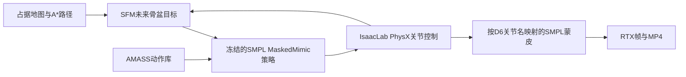

# Isaac Sim 6 / IsaacLab 3 行人模拟迁移

> 本文件记录上一轮迁移快照。后续训练、后端速度、数据、保存、录制与安装修正，以及
> 最新1,886项回归、两项本地资源验证和 G1 缓存根因，见 [当前完成报告](PROJECT_COMPLETION_20261001_ZH.md)。
> 下文原测试数字和 hash 仍保留为历史证据。

日期：2026-10-01。实现位于 `/project/EXP/SangforAndSaut/ProtoMotions`；
`/project/EXP/NavIsaaclab2.0` 用作源码和论文参考。

**现有 SFM + SMPL MaskedMimic 行人模拟已在目标环境完成物理、蒙皮和视频验收。**
最新测试是共享物理世界中的四人、240 步、8 秒、两次重置，输出80帧和8秒MP4。
严格论文的 Diffusion + AMP 尚缺匹配的模型、任务和数据定义，详见第六节。

## 1. 版本与环境

| 项目 | 本机实测 |
|---|---|
| Python | 3.12.13 |
| Isaac Sim 包 | 6.0.0.1，Kit 110.1.1 |
| IsaacLab 产品版本 | 源码 `VERSION=3.0.0` |
| IsaacLab Python 包 | `isaaclab==12.0.0` |
| IsaacLab 源码 | `4ecd0b036da19ff6ad2bb4d621f886b63e9f6db8` |
| ProtoMotions | 3.1.0，editable 指向当前工作树 |
| Torch | 2.11.0+cu128 |
| GPU | RTX 4080 SUPER，16 GB |

Lab 的产品版本与 Python 包编号不同；`12.0.0` 不表示没有安装 Lab3。
固定提交属于3.0开发线。官方 [beta2 对应 Sim6.0](https://github.com/isaac-sim/IsaacLab/releases/tag/v3.0.0-beta2)，
当前 [3.0 EA 要求 Sim6.1](https://github.com/isaac-sim/IsaacLab/releases/tag/v3.0.0-EA)。
本项目保留已适配并实测的提交，没有自动升级到 EA。

当前专用解释器：`../IsaacLab-Protomotions/.venv/bin/python`。
环境完整 manifest、锁与恢复工具见 [环境说明](../env/isaaclab3_sim6/README.md)。
对已经安装好指定 Sim 的工作区，可应用并检查固定配置：

```bash
cd /project/EXP/SangforAndSaut/ProtoMotions
../IsaacLab-Protomotions/.venv/bin/python scripts/isaaclab3_environment.py apply \
  --lab-root ../IsaacLab-Protomotions --sync
../IsaacLab-Protomotions/.venv/bin/python -I scripts/isaaclab3_environment.py check
source ../IsaacLab-Protomotions/.venv/bin/activate
```

工具会先验证 Lab 提交和现有 Sim，再备份和应用依赖配置。
`env/isaaclab3_sim6/` 内的源码路径相对于 Lab 工作区，不应直接在 profile 目录执行 `uv sync`。

已修复 `usd-core` 与 `usd-exchange` 对同一 `pxr` 二进制的覆盖；独立 Python 使用唯一
`usd-exchange==3.0.0` 提供者。独立 USD 为26.8，真实 Kit 内为25.11，分别验证。
234个相关 RECORD 哈希、USD 文件读写、转换器导入和真实 SMPL MJCF→USD→PhysX 路径通过。
保留的 Newton、schemas、coverage 三项元数据覆盖记录在 profile，不能将 `uv pip check`
的这三条差异误报为本次 PhysX 行人运行失败。

## 2. 实际控制链和修复



| 修复范围 | 当前实现 |
|---|---|
| 配置恢复 | 使用当前 `apply_all_inference_overrides`，显式设置动作库和控制频率，关闭弹射物；不复制旧空兼容函数 |
| 预训练推理 | `load_training_state=False`、`agent.eval()`、关闭梯度；真实运行验证30个归一化 buffer 未变化 |
| 后端数据 | 原生 articulation 为 XYZW；ProxyArray 显式取 `.torch`；Camera YAML 与 USD 边界单独转换 |
| 子集 reset | 局部行通过全局 `env_ids` 对齐目标、时间、缓存和冻结槽位 |
| 地面与共享世界 | 最小场景的地形偏移为 `[-40,-40]`，覆盖负坐标地图；`runtime.shared_world=true` 关闭克隆间碰撞隔离 |
| SMPL 姿势 | 识别 `body_x/y/z` 和 D6 `body_x:0/:1/:2`；未知/重复/不完整名称报错，删除猜关节排列的 fallback |
| SMPL 外观 | 本地 neutral 模型、按人区分的纯色、正确 MaterialBindingAPI 和 surface 输出；蒙皮成功后隐藏骨架，故障恢复骨架 |
| 地图 | negate、origin yaw、像素中心与世界坐标、越界/透明未知区域；重规划失败保留已验证路径 |
| 视频 | 录制频率来自真实控制时钟；有界 Kit 渲染更新，冻结物理推进；先写视频和证据再关闭会终止 Python 的 Kit |
| 其他共享入口 | 修复评估观测/done/初始路线、采集 CLI/路线变量、短动作采样资格和两份 PPO 的单样本尾批 NaN |

小规模行人配置默认 `humanoid.compile_components=false`，直接执行原张量计算函数，
避免首次 Inductor 编译等待。需要编译优化时可在 YAML 开启；模型参数与物理控制算法不变。
通用 ProtoMotions 训练仍保留原来的环境隔离和编译默认值。

源码、论文、骨架和权重详细对照见 [reference_comparison.md](migration_20261001/reference_comparison.md)。
NavIsaacLab 文件夹名中的2.0是项目名；其内嵌说明为 ProtoMotions3，不能据目录名判断核心是2.0。

## 3. 已接入的必需资源

| 资源 | 位置 |
|---|---|
| SMPL MaskedMimic actor | `data/pretrained_models/masked_mimic/smpl/last.ckpt` |
| 配套解析配置 | 同目录 `resolved_configs_inference.pt` |
| AMASS 验证动作库 | `../Assets/motion/amass_smpl_validation.pt` |
| SMPL neutral 参数 | `data/smpl/SMPL_NEUTRAL.pkl`，软链接到本机已有授权模型 |
| 物理骨架 | `protomotions/data/assets/mjcf/smpl_humanoid.xml`，24 bodies / 69 DOF |
| 最小场景与地图 | `CrowdSim/config/scenes/pedestrian_open.yaml`、`CrowdSim/maps/pedestrian_open.{yaml,png}` |

neutral 接入工具检查旧格式 pickle 和 SMPL 数组，保留原文件且不覆盖目标：

```bash
python data/smpl/install_local_smpl.py
```

默认源来自 `../arena_sangfor/arena_ws/arena_assets/smpl/SMPL_python_v.1.1.0/smpl/models/`。
换机器时应提供对应本地模型的 `--source`，重新建立链接。模型许可保持原约束。

AMASS train / validation / test 已具备，共11,786段、4,668,382帧。运行默认行人推理使用
验证库即可，不需要重新解压训练集。现有 SMPL MJCF 路径不需要缺失的旧 SMPL USD LFS 内容。
UV和纹理尚缺，当前使用真实 SMPL 的纯色表面；这不表示已经得到带服装纹理的人体外观。

## 4. 运行

以下命令在仓库根目录、上述专用环境中执行。

### GUI 连续行走

```bash
python -m CrowdSim.humanoid.simulate --num-humanoids 4
```

默认0步表示持续运行；关闭窗口或 Ctrl+C 结束。默认30 Hz与当前控制器的训练时钟一致。
入口固定为行人场景，无需机器人 PPO 权重或 Carter 资产。

### 无窗口物理、网格与视频验收

```bash
python -m CrowdSim.humanoid.simulate \
  --headless --steps 240 --num-humanoids 4 --reset-at 120 \
  --capture --output-dir output/pedestrian_simulation
```

输出 `result.json`、实际配置 `config.json`、`physical_states.npz`、RGB PNG 和
`pedestrian_motion.mp4`。每3个控制步采一帧，MP4为10 FPS、8秒；渲染没有增加控制步。
状态和动作必须有限、骨盆不能低于0.35米、网格必须继续更新、图像必须有效且变化，
归一化统计必须保持冻结；异常输出失败状态并保留非零退出码。

可用选项：`--config`、`--seed`、`--capture-every`、`--control-hz`、`--no-mesh`。
`--no-mesh` 是显式物理骨架模式。只做物理验证时省略 `--capture`。
改变人数、地图、速度、时钟或场景后，应重新检查跌倒、路径与几何对齐。

## 5. 验收证据

最新结果：[四人报告](migration_20261001/runtime/smpl_render_final_result.json)、
[视频](../output/migration_validation/smpl_render_final/pedestrian_motion.mp4)、
[首帧](../output/migration_validation/smpl_render_final/frame_000000.png)、
[末帧](../output/migration_validation/smpl_render_final/frame_000237.png)。

| 真实四人测试 | 结果 |
|---|---|
| 控制频率 / 时长 | 30 Hz / 240步 / 8秒 |
| 重置 | 2次：一次指定子集重置，另一次环境结束重置 |
| 最低骨盆高度 | 0.8431米 |
| 排除 reset 传送后的行走距离 | 4.99 / 4.72 / 3.91 / 3.76米 |
| 网格 / 物理世界 | 四个彩色 SMPL 可见，D6姿势映射，共享 PhysX 碰撞 |
| 图像 / 视频 | 80帧，10 FPS，8秒MP4；首末帧已人工查看 |
| 策略归一化 | 30个 buffer 保持不变 |

独立的25 Hz兼容测试也通过：两人、100步、4秒、一次子集重置，最低骨盆高度0.8023米，
输出20帧、5 FPS、4秒MP4。见 [25 Hz报告](migration_20261001/runtime/smpl_25hz_result.json)。
默认仍使用预训练控制器的30 Hz；短时兼容不表示改变时钟后的动作质量与训练时相同。
两个MP4均已独立解码检查帧数、时长和图像变化，见 [视频验证](migration_20261001/runtime/video_verification.json)。

修复前地形没有覆盖负坐标地图，人体自由落体到约-77米。
旧脚本仅检查有限值而误标 passed，保留的 `runtime/result_before_ground_alignment.json`
是失败反例，不能作为有效验收。首次 Replicator 同步采集也因等待首帧超时；当前使用
IsaacLab 的 Hydra 初始化契约及有界渲染路径，已实际输出视频。

最终单元/集成回归：**1,750 passed、2 skipped、5 deselected**。结果及范围见 [最终测试日志](migration_20261001/runtime/migration_final_tests.log)
和 [JUnit](migration_20261001/runtime/migration_final_tests.xml)。已知的 Newton/G1 CUDA FK
位置误差约3.097毫米（门限1毫米）仍未解决，最终目标回归排除了这一项；四项 LFS 测试未选，
两项旧 IsaacGym 测试跳过。不能将本次 SMPL/PhysX 通过泛化为所有后端已无问题。

这里验证的是短时行走、子集重置、蒙皮及渲染，不是论文200秒密集人群评测。
最小场景是无障碍地面；没有宣称仓库、医院等缺资源场景的碰撞与地图已验收。

## 6. 严格论文复现还缺什么

1. 论文 IV-A 的条件轨迹 diffusion 实现、匹配权重、H/N/M 条件和轨迹训练数据定义。
2. IV-B 的 SMPL 导航 AMP actor/critic、训练任务、归一化、奖励和轨迹接口；现有
   MaskedMimic、SOMA AMP、G1 AMP 不能当作这个 SMPL AMP 控制器。
3. IV-C 的2,848段 AMASS locomotion 精确清单、片段范围、标签筛选与划分。
4. 论文场景、起终点、人群参数、种子，以及200秒行人质量/碰撞评测和 Motion-MMD 的完整协议。
5. 选择相关场景时，仍需四套 DynBench 地图、KLT/叉车/HDR 等外部引用；机器人扩展还需
   可用 Carter 资产及对应机器人策略。它们不属于本次最小行人入口的必需权重。

当前实现能够运行现有 SFM+MaskedMimic 路线。论文的 Diffusion+AMP 和 SFM+AMP
需要上述资源与任务配置，尚未按论文结果完成复现。
