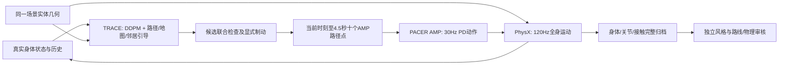

# TRACE + PACER AMP 行人模拟：实现与验收

## 2026-10-08：真实 Warehouse 新一轮 Diffusion+AMP 优化

已完成固定2848 AMASS / 512次微调 / 2,097,152实际物理样本；四人原始Warehouse完整200秒，零跌倒、零>1N静态和行人接触，54个路线节点，实际退出0。30秒30fps室内+跟随视频已完成。姿态稳定性和部分姿态指标改善；按速度条件的动作MMD与覆盖仍退步。

详见 [Warehouse 当前结果](WAREHOUSE_DIFFUSION_AMP_ZH.md) 与 `warehouse_diffusion_amp_evidence_index.json`。本次一场景工程复现不等于作者完整八场景协议。此前AMASS anchor512和旧Social AMP结果保留为历史对照。


## 本轮完成：固定2848 AMASS微调与实际场景验收（2026-10-08）

本地AMP已完成**128环境、512更新、2,097,152真实物理转移**，2848训练motion ID均进入专家采样。
权重、冻结归一化统计和完整导出推理均通过独立CPU核验。
四人相向200秒及同向绕障60秒分别普通实际退出0，各通过10项独立物理门槛，均零跌倒、零行人/障碍法向接触。
初始化后重置0次；两场共7800控制步/31200物理子步，不包含训练重置。

- 微调权重：`data/pretrained_models/local_amass_finetune/anchor_20261008/Humanoid_AMASS.pth`。
- 明确选择本地微调配方：`configs/diffusion_amp/trace_pace_amass_finetuned.json`。
- 训练、场景、独立风格/步态、录像和SHA来源：[完整操作与证据](AMASS_FINETUNE_ZH.md)。
- 录制读取同一次真实PhysX状态，逐帧标注源时间；使用IsaacSim6 RTX纹理SMPL，可复录完整200秒。
- 相向场景47路线节点、23通过代理；脚底支撑99.879%以上，支撑脚原点速度代理0.06442m/s。
- 风格MMD及K50/K100覆盖略差于公开基线，**没有证明风格改善或达到原论文整体效果**。

这只是seed7、两种四人平地实体障碍场景的局部质量验收；不是原论文8场景/3–15人的总体认证。
同向场景原退出-11及早期录像失败完整保留，复跑和正常退出录像分别使用新目录。
完整物理/录制父进程收据而不是子进程打印passed决定是否验收。

## 此前公开权重基线与历史记录

下述“最新/当前/未微调”对应此前公开权重基线，局部微调终态以本页顶部和AMASS说明为准。


## 当前验收结论

**最新受控四人双向往返200秒已完成并通过独立物理审核**：
`trace_amp_bounded_reciprocal_200s_v3`，种子7，6000/6000次控制、24000个PhysX子步。
普通父进程`Popen.wait()`实际退出0，48项执行源码与冻结输入不变，SDK正常清理；
7类临时控制对象在关闭SDK前均已释放，初始化后人体重置0次。

| 项目 | 最新200秒实测 |
|---|---|
| 跌倒 / 行人接触 / 障碍接触 | 0 / 0 / 0；全部身体每个物理子步测量，法向接触阈值>1N，最大接触力0N |
| 路线节点 / 真实路程 | 每人12节点、共48；每人145.60–149.00m |
| 相向通行 | 26个对向接近区间，25个纵向通过代理；最小实际根部间距1.585m |
| 停滞 / 地图包络 | 最长连续低速0.567s，无节点间隔最高19.77s；最小身体包络地图距离2.110m |
| 脚底物理支撑 | 每人至少一脚支撑子步99.875%–99.971%；平均载荷约621N/人，与体重比0.9999–1.0003 |
| 步态 | 左右稳定单脚支撑起始交替中位1.76–1.875Hz；支撑脚身体原点速度代理0.0691m/s |
| 实际速度与制动 | 均速0.74m/s，瞬时最高2.030m/s；402次规划中49次用了明确解析制动，未声称全部为DDPM |
| 风格 | 全部23996合法区间；45D姿势MMD²=0.03180，90D速度分桶MMD²=0.07047，K50/K100覆盖0.52/0.39 |
| 计算成本 | 平均规划1.594s，200s物理预算耗时约1202s；未达到0.5s实时规划预算 |

修正后的靠右成本只作用于膨胀栅格窄走廊，12m往返路线长12.62–13.24m；不会再因为全局靠墙代价绕行40m。
相同配置独立60秒也普通退出0、10项门槛通过、12节点/8次相向通过/零跌倒接触。
75项CPU测试及Ruff通过。源代码、资源、完整记录和独立评估均有摘要与实际终态。

**范围**：公开TRACE/PACER权重、平地实体障碍、四人、seed7、明确靠右规则。
采用相同模型/源码/输入/种子，两次物理运行的前60秒轨迹仍不逐位相同；初始位置差约4微米，
后续运动可分歧，固定种子不构成GPU物理逐位确定性保证。
全部120Hz方向诊断显示移动时朝向对齐余弦中位约0.98，反向移动占全部子步3.32%–4.76%，最长1.89秒；
它们包含掉头和反应动作，仍需进一步改善动作质量。没有以删去这些帧的方法提升风格。
当前不认证主观真人观感、接触斑滑移、3–15人/多种子/多地形可靠性或作者私有八场景分数。
本地固定2848真实AMASS保留，本入口公开AMP权重尚未在该清单上微调。

## 当前方法

依据 [Trace and Pace 论文与作者项目](https://research.nvidia.com/labs/toronto-ai/trace-pace/)、本地 `TraceAndPace/trace` 与 `TraceAndPace/pacer` 实现，以及 [NavIsaacLab IV-A/IV-B](https://arxiv.org/html/2606.26265v1#S4)。目标是实际 PhysX 运动、可检查的路径与真实动作，而非要求全部指标超过论文。

- **轨迹规划**：作者公开 TRACE `orca_mixed/iter40000.ckpt`，完整100步DDPM、时间U-Net、真实历史/邻居与语义地图；对干净轨迹施加定时路径点、地图距离场、行人间距、运动能力引导。
- **动作生成**：作者公开 `pacer_no_shape/Humanoid.pth`，严格SHA256和完整张量/RMS检查；基于真实身体状态、10个路径点和地形生成69维PD动作，交由物理引擎执行。
- **采样时钟**：公开PACER原`HumanoidTraj._fetch_traj_samples`用`arange(10)*0.5`，即0..4.5秒；桥接默认对齐该时钟，0.5..5秒仅作为显式历史适配。独立测试执行作者原采样函数并与插值输出比较。
- **闭环**：120Hz物理、30Hz动作；每15次真实控制重新规划（安全监测可提前触发）；规划历史只读取已经发生的运动。最终窗口不足时显式保持终点，记录保持点数。
- **多人规划**：同一物理世界的候选组合共同检查；有界搜索支持不同样本编号，混合后重新检查行人间距。独立环境不会彼此施加避让损失。
- **能力约束**：采样积分中限制速度、加速度、转向；真实初始速度高于巡航上限时，以可实现的减速度逐步降低。结束后恢复原模型参数，不裁剪世界坐标或重置人体。
- **可选安全制动**：单独配置开启；扩散候选均不安全时，检查以实际速度平稳减速到停步的轨迹，继续使用同一AMP生成动作。样本编号为 `-1`，单独计数和标记；制动也不安全则退出并保存失败。这是本地可靠性适配。
- **实际速度监测**：30Hz检查实际速度的几何预测（旧配方1秒；环行配方2秒并留0.5m跟随余量）；接近障碍或相向行人时提前制动。静止且未继续接近的行人不触发反复制动。正常社交缓冲0.2m，制动缓冲0.05m；身体包络半径保持。社交缓冲渐进恢复，不能放宽物理包络。
- **轨迹坐标**：作者 ORCA 加载器用 `atan2(vy,vx)` 表示运动方向；TRACE输入据此转换，地图从同一几何按新方向重新采样。身体四元数仍是实际物理姿势，AMP独立读取。可选静止路径方向只在速度小于0.1m/s时为轨迹模型提供当前路径切线，不改变人体朝向或位置。
- **停步目标保持**：环行配方开启固定停步目标。首次解析制动确定停止位置，持续制动时AMP目标保持该位置，恢复扩散后解除；准入仍单独用最新实际速度生成因果制动预测。控制目标不是人体瞬时到达该点的声明。
- **分别制动**：保守步行配方在16条真实DDPM候选之外，明确加入每人一条解析制动候选。有风险的人固定选择制动，其他人可继续选择扩散候选；整个组合重新通过几何/动力学检查。编号`-1`始终表示解析制动，`candidate_sources`明确每个候选来源。无安全组合时仍保存失败退出。
- **可选靠右通行**：`shared_obstacle_trace_pace_keep_right.yaml`使用同一障碍和原交叉目标节点，基于膨胀地图的有向A*成本偏好右侧通行；当前仅在栅格横向空间不超过4m的窄走廊施加代价，开阔空间保留原距离成本，避免40m绕行；不直接给人体设置路线状态。目标节奏为0.9m/s，扩散速度上限仍为1m/s。全局栅格按单元与障碍相交标记占据，防止25cm网格漏掉20cm墙。每次DDPM规划（包括安全提前规划）刷新当前真实位置的路径查询。这是明确的本地交通规则，不能等同完全无约定的相向避让。
- **持续通行**：循环路线每人连续低于0.1m/s超过20秒，或有界场景60秒没有到达路线节点即退出，记录停滞原因。
- **接触记录**：`--measure-contacts`适用于明确的四人共享场景，记录120Hz脚底法向力、真实COM/质量、全部身体对行人/静态障碍的接触。N4原生所有者在停止时间线前释放自建接触视图，并核验普通进程终态。未测量摩擦力或接触斑滑移。

代码入口：`scripts/run_trace_pace.py`。规划/引导在 `CrowdSim/humanoid/diffusion/`，闭环在 `CrowdSim/humanoid/runtime/trace_pace.py`，可逆记录在 `CrowdSim/humanoid/analysis/trace_pace_capture.py`，独立风格入口为 `scripts/evaluate_trace_pace_style.py`。

## 模块结构

```text
configs/diffusion_amp/trace_pace_*.json         权重摘要、采样、能力与安全参数
configs/diffusion_amp/shared_obstacle_trace_pace_*.yaml  同一物理/规划几何及路线
CrowdSim/humanoid/diffusion/{planner,guidance}.py       DDPM与联合候选检查
CrowdSim/humanoid/amp/controller.py                公开PACER权重严格加载与AMP动作
CrowdSim/humanoid/runtime/trace_pace*.py      闭环与原生生命周期
CrowdSim/humanoid/runtime/keep_right_planning.py     可选全局交通规则
CrowdSim/humanoid/runtime/trace_pace_scope.py        已结束控制对象的释放与核验
CrowdSim/humanoid/analysis/trace_pace_capture.py       可变候选归档
scripts/run_trace_pace{,_verified}.py         物理执行与父进程收据
scripts/evaluate_trace_pace_{style,reliability,gait}.py 独立完整帧评价
scripts/visualize_trace_pace.py               实际位置/速度曲线与骨架动画
```



AMP的判别器用于作者原训练时约束AMASS动作风格；运行时由已训练的演员策略输出PD动作，
不会逐帧播放AMASS，也不需要在每个模拟步调用判别器。该策略的AMASS来源与本地固定2848清单分别标注。

## 与 NavIsaacLab 的对应及差异

| 项目 | 本地实现与限制 |
|---|---|
| Diffusion + AMP 分层闭环 | 真实DDPM规划 + 真正训练过的AMP控制器 + PhysX全身动作 |
| 历史、邻居、障碍、5秒目标 | 真实历史与邻居、相同物理立方体/地图、规划引导0.5..5秒目标；公开AMP输入0..4.5秒10点 |
| 模型 | 使用公开TRACE/PACER基线；Nav作者适配权重与完整配置未公开 |
| 轨迹状态 | TRACE action-space unicycle，与Nav论文直接五状态扩散存在差异 |
| AMP判别器 | 公开PACER为10帧身体状态；Nav要求的历史加动作2019维训练支路保持独立 |
| 重规划频率 | 本地0.5秒；Trace and Pace Sec3.3为2秒，属于明确的可靠性适配 |
| AMASS2848 | 本地真实固定v7清单包含训练2848、验证22、测试34条选定动作，仍保留；本入口公开权重未在该清单上重新训练，不作此声明 |
| 多样地形/体型/价值函数引导 | 作者PACER具备相应训练，本轮采用公开no_shape策略及单一SMPL；只测平地实体障碍，未验证坡阶/混合体型，未移植价值函数引导 |
| 场景和指标 | 目前为本地受控测试；不是作者8场景200秒结果。接触模式有真实法向力，几何预测仍不等同实际接触 |

本地 `/project/EXP/NavIsaaclab2.0/CrowdSim/humanoid/README.md` 的当前诊断入口使用SFM与MaskedMimic；`nav_manager.py`记录未来目标和身体反馈。该现有接口与论文Diffusion+AMP方法分别注明，新入口执行真实PACER AMP。相关读取文件摘要在`nav_local_interface_sources.json`，没有改动Nav2原诊断入口。

公开代码版本：TRACE `594b2af0824c5853e1a1884e167cd5ed097dd81c`；PACER `baeb6241f03fc9d78370a64e3c2dcef9d830d97f`。引导参考原 `tbsim/utils/guidance_loss.py`。距离场、能力约束、有界联合选择和可选制动均为显式本地适配。

## 已有资源与接入约定

以下资源位于`/project/EXP/SangforAndSaut/ProtoMotions/`，运行配置严格核对完整SHA256：

| 资源 | 仓库相对位置 |
|---|---|
| TRACE ORCA扩散权重与原配置 | `data/pretrained_models/paper_references/trace/ckpt/trace/orca_mixed/{iter40000.ckpt,config.json}` |
| 公开PACER AMP演员权重 | `data/pretrained_models/paper_references/pacer/output/release/pacer_no_shape/Humanoid.pth` |
| 固定真实AMASS v7清单 | `data/diffusion_amp/amass_style_2848/manifest_labeled_v7.json`，训练2848/验证22/测试34 |
| 实际SMPL人体及关节/PD映射 | 当前ProtoMotions SMPL配置与资源，运行时核对69自由度/24身体、完整权重/RMS形状及实际物理映射 |
| 风格参考 | 冻结验证22、K50/K100中心，具体路径和SHA记录在每个风格报告 |

`TracePaceClosedLoop.action(world, control, route_targets, ...)`依赖实际世界对象的
`planner_inputs()`、`state()`和AMP观测接口。`planner_inputs()`提供真实`[x,y,vx,vy,yaw]`、
历史、邻居及同一实体几何栅格；AMP独立读取实际身体四元数/关节/地形。
`route_targets`是世界坐标XY点，不是人体位姿命令。输出69维PD动作只经物理步进执行。
可选`route_target_provider`在每次真实重规划前查询最新路径；目标与地图使用同一运动朝向坐标。
共享世界使用相同scene ID，独立环境不得互相避让。

Nav2现有MaskedMimic目标姿态接口不能直接接收这些69维动作；目前验证入口为ProtoMotions的
`AMPWorld`与`run_trace_pace.py`，尚未将Nav2整套机器人导航主程序替换为新控制器。
移植到新的场景时必须提供同一碰撞几何的栅格与地形观测，重新评价接触/路线/步态；
不能沿用旧朝向地图或把当前受控验证证明转移到未测场景。

## 可复现运行

使用固定SDK环境，实测版本在证据目录`runtime_environment_v1.json`；运行前完整核对资源SHA。
本入口加载作者PyTorch权重并调用当前IsaacLab/PhysX，不依赖作者旧IsaacGym执行环境。
输出必须是新目录。默认推荐四人往返走廊；流量偏好为明确本地适配。

```bash
cd /project/EXP/SangforAndSaut/ProtoMotions
PYTHON=/project/EXP/SangforAndSaut/IsaacLab-Protomotions/.venv/bin/python

"$PYTHON" scripts/run_trace_pace.py --preflight-only --output output/trace_pace/preflight_new

# 纯DDPM单人：行走、转弯与停步
"$PYTHON" scripts/run_trace_pace_verified.py --output output/trace_pace/single_new -- \
  --steps 360 --seed 7

# 受控四人：相同实体几何、左右走廊各两人往返，解析制动显式计数
"$PYTHON" scripts/run_trace_pace_verified.py --output output/trace_pace/reciprocal_new -- \
  --steps 6000 --seed 7 --measure-contacts \
  --config configs/diffusion_amp/trace_pace_crowd_locomotion.json \
  --scene configs/diffusion_amp/shared_obstacle_trace_pace_reciprocal.yaml

# 短测可改为 --steps 1800；同向基线场景如下：
# configs/diffusion_amp/shared_obstacle_trace_pace_circulation.yaml
# 交叉目标/局部靠右场景如下（历史流量曾主要为环行）：
# configs/diffusion_amp/shared_obstacle_trace_pace_keep_right.yaml
```

必须由父进程`Popen.wait()`保存真实退出，不把日志`passed`算作成功。
每次保存`_execution.json`、`.log`、`_inputs/`及`_sources/`；当前48项运行源码与全部输入在终态再次核对。
历史证据只证明自己的快照版本。物理记录、模型SHA、AMASS清单SHA、种子和控制预算均归档。
普通失败退出完整保留，评估器拒绝段错误、不完整预算、变化的来源或损坏归档。

```bash
PYTHONDONTWRITEBYTECODE=1 PYTEST_DISABLE_PLUGIN_AUTOLOAD=1 CUDA_VISIBLE_DEVICES='' \
OMP_NUM_THREADS=2 MKL_NUM_THREADS=2 OPENBLAS_NUM_THREADS=2 \
"$PYTHON" -m pytest -q -p no:cacheprovider \
  tests/test_diffusion_trace.py tests/test_amp_pacer_adaptation.py \
  tests/test_trace_pace_reliability.py tests/test_paper_reconstruction_scene.py

RUN=/absolute/completed/run
RECEIPT=/absolute/completed/run_execution.json
"$PYTHON" scripts/evaluate_trace_pace_reliability.py --run "$RUN" --execution "$RECEIPT" \
  --output /absolute/new_reliability.json
"$PYTHON" scripts/evaluate_trace_pace_style.py --run "$RUN" --execution "$RECEIPT" \
  --output /absolute/new_style.json
"$PYTHON" scripts/evaluate_trace_pace_gait.py --run "$RUN" --execution "$RECEIPT" \
  --output /absolute/new_gait.json
"$PYTHON" scripts/inspect_trace_pace_encounters.py --run "$RUN" --execution "$RECEIPT" \
  --output /absolute/new_encounters.json
"$PYTHON" scripts/visualize_trace_pace.py --run "$RUN" \
  --scene /absolute/completed/run_inputs/scene.yaml \
  --output /absolute/new_visual --animation --support-plot --actor 0 --start-seconds 20 --duration-seconds 6
```

可靠性评价自动使用收据绑定的冻结场景，避免改过配置后误用新几何。
`physical.npz`记录实际身体/根部/关节/PD动作及所有轨迹；不同候选数使用offset无填充归档，
`planning.json`明确DDPM/制动来源和编号。接触模式保存全部120Hz子步的真实身体/COM/质量/脚底法向力及
全部身体对行人/实体障碍接触；阈值严格大于1N。风格读取全部合法区间，Test34不参与选型、不重新拟合参考。
支撑脚身体原点速度与左右支撑交替是步态代理，未测接触斑滑移/摩擦，也没有主观自然度认证。

## 已有证据及验收边界

2026-10-08，本轮真实进程检查：

- 公开PACER直接控制：360次控制/12秒，退出0、零跌倒，位移4.67m，平均固定路线误差0.21m，清理成功。
- TRACE100步DDPM + PACER完整闭环v3：360次控制/12秒，退出0、零跌倒，位移4.53m，平均固定路线误差0.434m，停步阶段平均速度0.0167m/s，清理成功。
- v3规划平均耗时1.094s，大于0.5s重规划间隔。当前属于离线物理复现，尚未验证实时运行。
- 多人纯扩散测试揭示安全候选耗尽，所有失败目录保留。不会把这些测试算成完成12秒或论文导航成功。
- 历史单人v4：360/360控制，退出0、零跌倒、无重置，平均路线误差0.585m、停步速度0.0534m/s。
- 历史四人guarded v4：360/360控制，退出0、零跌倒、无重置；位移6.67/5.22/8.73/8.88m，11次显式制动，最小实际根部间距1.171m，身体包络至地图最小距离0.138m。该距离不等同实测接触力。
- 四人短测独立风格：冻结验证参考，90维速度分桶MMD²=0.06054、45维姿势MMD²=0.02468；这不是作者分数。359×4个合法帧间区间全部保留，首帧用于差分上下文。
- 实际身体瞬时速度最高约2.77m/s，尽管规划上限1.4m/s。轨迹能力约束不能直接保证物理速度；必须分别记录、评价。
- 原guarded200秒：完成6000控制、实际退出0、零跌倒，但仅7路线节点，最长低速95.5/135.0/182.8/65.5秒，独立质量失败。不会提升为可靠导航结果。
- 原接触短测发生退出-11，原始记录保留。调试器未复现故障，不作为普通进程成功证明。修正原生接触释放顺序后的v3普通短测退出0：30控制/120物理子步，零行人/静态接触；每人平均脚底法向载荷613/611/655/648N，对应体重0.99/0.98/1.06/1.04倍，支撑子步比例0.96/0.97/0.83/0.95。
- 较小缓冲的步行测试因路径查询/候选安全检查中止，失败前零跌倒、零实测接触，完整失败目录保留。短测正常退出不能保证长期通行。
- 原PACER时钟、薄墙与新路线刷新修正后75项定向CPU测试及原场景兼容性检查通过。宽缓冲交叉场景v1在1176控制/39.2秒因网格重接范围不足中止，7节点、零跌倒/实测接触、实际退出1；v2在389控制因身体间距不足中止，实测行人接触最高约310N，实际退出1。同向环行v1在748控制/24.93秒、6节点后因制动预测无法绕墙停止，零跌倒/实测接触、退出1。保持停步目标v2完成200秒，实际退出0、独立质量审核通过，但采用旧的0.5..5秒AMP采样，作为历史适配证据；当前公开PACER时钟修正后单人360控制/12秒已实际退出0：平均路线误差0.216m、停步速度0.0355m/s、零跌倒；四人200秒已完成，普通实际退出0且独立审核通过。

### 当前原PACER时钟：环行200秒

`trace_amp_native_clock_circulation_200s_v1`完成6000控制、24000物理子步、普通退出0，源码/冻结输入不变。
当前控制器采样0..4.5秒，规划引导仍查询0.5..5秒。四人各6节点，共24；各自实际路程78.64/73.28/73.11/77.24m，
最长连续低速1.2秒，最长节点间隔36.67秒。最小根部间距4.939m，最小身体包络地图间距2.071m。
零跌倒、零全部身体对行人/静态障碍法向接触，平均脚底载荷约621N/人，体重比例0.9999至1.0003，
至少一只脚支撑的子步比例99.97%至100%。这是单种子、同向环行的结论。
**没有选用解析制动**：所有实际执行路径均是DDPM候选，200秒使用公开AMP物理动作。
均速约0.378m/s，瞬时速度峰值约1.513m/s。全部23996合法风格区间：45D MMD²=0.04927、
90D速度分桶MMD²=0.08694，K50/K100覆盖0.40/0.28；均为本地冻结参考指标。
测得支撑脚身体原点速度代理约0.098m/s，间隔端点双接触代理约0.0576m/s；未测接触斑摩擦/滑移。
平均规划1.341秒，仍未验证实时运行。路线、接触、风格分别保留原始结果。
独立步态诊断包含每人24000个原生子步：左单脚支撑19.5–21.4%、右单脚支撑21.0–22.3%、
双脚支撑56.5–59.5%，无支撑0.004–0.029%；稳定单脚支撑交替起始频率中位数2.14–2.31Hz。
该诊断按50ms去抖统计支撑阶段，原始支撑比例不删除任何子步；不是作者步态分数或视觉真实性证明。

### 当前交叉目标与靠右通行验证

原采样时钟`trace_amp_native_clock_crossing_200s_v1`在1800控制/60秒后因为无人到达节点退出1：
零跌倒、零实测行人/障碍接触，但四人形成停滞队列；90次规划使用了显式制动。
失败收据、完整前缀和`native_clock_crossing_v1_failed_forensics.json`保留，不进入成功/风格准入。

`trace_amp_native_clock_keep_right_200s_v1`完成6000控制/200秒，24个目标节点、零跌倒/实测接触，
但清理返回后父进程捕获`-11`，不准入成功评价。相同原始交叉目标与物理几何，
加入明确靠右交通规则及0.9m/s定时目标；实际运动没有满足诊断定义的近距离相向会车事件，
不能以这个实验宣称会车可靠性。完整失败收据与`native_clock_keep_right_v1_failed_forensics.json`保留。

修订入口把物理循环放入独立函数作用域：临时身体状态、控制器/规划器及动作张量须在SDK关闭前释放，
通过弱引用记录存活对象并同步CUDA。实际短测发现仅函数返回或仅`frame.clear()`仍保留对象：
Python3.12已经物化的locals缓存字典继续引用全部循环状态。CPU测试复现后，入口仅清理其自己
已结束的物理栈帧及locals缓存，拒绝其他或执行中栈帧；SDK关闭后恢复故障诊断。最新普通短测v5实际退出0、清理正常、7类受监测控制对象在SDK关闭前均已释放。
同一版本完整200秒`trace_amp_scoped_keep_right_200s_v2`已普通退出0，6000/6000控制，48项执行源码/冻结输入不变。
7类受监测对象在SDK关闭前均已释放；完整路线、物理、风格及步态评价实际退出0。
仍不能据此证明所有原生SIGSEGV已解决。父进程来源范围补充AMASS加载、实际SMPL配置及本地物理/状态转换源码。

这次200秒各人6节点，最小根部间距1.813m、身体包络地图距离2.099m，最长连续低速1.03秒，
无节点间隔最高49.97秒。实测全部身体对行人/实体障碍接触力0N；至少一只脚支撑子步99.97%至100%，
支撑脚身体原点速度代理0.0622m/s，未测接触斑滑移。均速约0.79m/s，实际瞬时速度最高1.523m/s。
400次规划中1次使用解析制动，平均规划1.367秒。风格45D MMD²=0.03580，90D速度分桶MMD²=0.08398，
K50/K100覆盖0.34/0.28。由于路线与节奏不同，这不是和旧环行配对比较，也不宣称全面改善风格。
全部原生支撑子步包含，稳定单脚支撑交替起始频率中位数1.76Hz；相向通过代理2次，最小间距1.81m。
旧靠右代价后来被发现导致多数交通绕圈，因此这两个事件不等同持续双向走廊可靠性。

`trace_amp_scoped_reciprocal_60s_v1`普通退出0，但检查发现两条往返规划路径长40.21m、实际会车代理0，
只保留为绕行缺陷证据。新版`right_hand_corridor_width_m: 4.0`限定窄走廊成本，
四条全局路径长13.24/12.62/12.62/13.24m；增加同侧走廊/最大18m长度/身体地图及相向间距测试，
防止把长距离绕行误判为相向分道。新版60秒`trace_amp_bounded_reciprocal_60s_v2`完整1800控制/7200子步，普通退出0、来源/输入不变，
10项独立路线/物理门槛全过，各人3节点共12，最长连续低速0.567秒，最长无节点17.2秒。
8次同侧走廊相向通过代理、最小根部间距1.681m、最小身体包络地图距离2.062m；零跌倒、零实测行人/静态接触。
脚部支撑≥99.72%，载荷与体重比例约0.9998–1.0012，支撑脚身体原点速度代理0.0674m/s。
16条DDPM与1条解析制动明确混合，121次规划中13次有制动；左右支撑交替中位1.76–1.875Hz。
风格完整7196区间，90D速度分桶MMD²=0.06770；平均规划1.252秒，仍不是实时。
同一源码200秒`trace_amp_bounded_reciprocal_200s_v3`已普通退出0、独立路线/物理/风格/步态评估退出0。
完整数据见顶部表格和`bounded_reciprocal_v3_{reliability,style,gait,encounters}.json`。
26个对向接近区间中25个满足纵向通过代理；剩余区间未满足此定义，未删去或改写。
这些是明确交通规则、同一稀疏四人场景的局部证据，不是无约定拥挤会车或作者8场景统计。
复跑前缀差异保留在`bounded_reciprocal_prefix_repeatability_v1.json`，不宣称逐位相同。

### 已完成环行v2（旧AMP采样时钟）

四人200秒、6000控制、24000实际物理子步，普通父进程退出0；源码及冻结输入不变。
独立逐值核对全部24身体位置/根部四元数与最后原生子步。每人15/16/16/16节点，共63，
最长无节点间隔16.87秒，最长连续低速0.73秒；实际身体包络至地图最小1.501m，根部间距最小1.467m。
全部行人/实体障碍法向接触力为0；脚部支撑子步比例98.3%至98.8%，平均法向载荷与体重比0.9999至1.0003。
支持脚部身体原点速度代理平均0.106m/s；尚未测接触斑滑移或摩擦。
完整23996合法风格区间：45D姿势MMD²=0.03532，90D速度分桶MMD²=0.07922，K50/K100覆盖0.40/0.37。
公开PACER训练ID未知，这些是本地独立参考指标。平均规划1.265秒，仍未达到0.5秒实时预算。
此轮AMP输入从0.5秒开始，必须与后续对齐公开控制器0秒采样的新结果区分。

最小受控验收要求完整控制预算、真实退出0、零跌倒、每人位移超过0.3m；单人固定路线平均误差不超过1m、最后停步速度不超过0.15m/s。它验证短时控制可用性，不能替代长时间群体可靠性或原论文指标。

独立风格检查使用既有冻结AMASS验证动作/聚类中心，包含实际全部帧、不重新拟合生成结果，Test34不参与选型。局部MMD²及近地脚部代理与作者私有指标实现不同；公开PACER训练动作清单未知，不能证明与作者训练集完全无重叠。

独立可靠性入口审核实际完整预算、身体包络、每人路线节点和连续低速；循环路径超过20秒连续低速会失败。风格输入包括全部真实帧；速度/加速度在合法相邻帧/三帧上计算，姿势比较使用区间末帧。身体包络和近地脚部运动仍是代理。接触模式逐值核对身体/四元数与最后原生物理子步，风格使用该子步的COM和脚部接触掩码；法向力与自然度分别报告。

下一阶段需补全：无交通约定/拥挤交叉会车可靠性、掉头的反向移动/速度峰值及SDK异常退出根因；多种初始化/种子；真实摩擦与接触斑滑移；同一AMP下DP/SFM配对；固定2848的可靠微调及完整Nav判别器接口。AMASS真实性与当前权重在其上训练过是两件分别核验的事实。

## 原生退出的限制

交叉路线v3使用固定停步目标但仍因20秒停滞失败（1107控制/36.9秒、零跌倒/实测接触），
清理日志后实际父进程捕获`-11`。已完成环行v2普通退出0不能证明其他路径的退出可靠性。
`isaac-sim-troubleshooting`提供的是挂起/内存等启发式检查；本地`SimulationApp.close()`已使用
`app.shutdown()`，与[官方6.0发布说明](https://docs.isaacsim.omniverse.nvidia.com/6.0.0/overview/release_notes.html)
中挂起修正一致，不能据此认定当前SIGSEGV根因。宿主core限制为0，未获得这次原生堆栈。
当前父进程按真实退出码拒绝失败，未使用快速强退来生成成功。来源见`shutdown_diagnostic_v1.json`。
后续诊断可在相同命令前设置`PYTHONFAULTHANDLER=1`，保留失败退出和完整日志。

## 原训练状态

episode2000训练已于2026-10-08 10:54:27（上海）实际退出0：2000更新、16,384,000物理转换，CPU审计退出0。其22条完整跟踪为0/22成功、6条发生跌倒；导航短测退出-11，200秒未启动。该权重未提升为部署权重。本轮先以可核验的作者公开AMP建立可靠物理基线。
