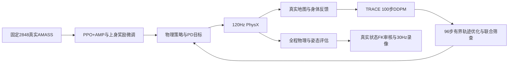

# YOHO 行人模拟：姿态微调、速度优化与实际录像

## 2026-10-09：YOHO 本轮验收与录像

固定2848真实AMASS保守微调128更新、524,288实际物理转移；部署权重 `data/pretrained_models/local_amass_finetune/upperbody_20261009/Humanoid_AMASS.pth`。四人/seed7在用户YOHO源场景的冻结副本完成200秒、6000控制步/24000物理子步，普通实际退出0、零跌倒、初始化后重置0次，全部11项本地物理检查及每人行走姿态筛查通过。

| 实际指标 | 200秒结果 |
|---|---:|
| 全程平均根速度 | 0.570m/s |
| 实际根速度p95/最大值 | 0.747/1.202m/s |
| 行走帧平均根速度 | 0.575m/s |
| 行走头部相对骨盆侧倾p95 | 4.867° |
| 行走肩线相对骨盆扭转p95 | 7.252° |
| 行走摆臂绝对角p95 | 16.995° |
| 全帧摆臂最大绝对角 | 26.964° |
| 全帧手臂过水平次数 | 0 |
| 每人经过路线节点 | [219, 218, 222, 221] |
| 速度条件风格MMD²（本地22验证动作） | 0.08385 |

新初始化从真实AMASS的完整10帧历史选择双脚着地、低速、双臂下垂姿态，模拟从第一控制步直接行走。录像展示连续源控制帧0..899：先15秒女洗手间区域，再15秒男洗手间区域；4人始终共同运行。900帧/30fps/960×720，两个镜头实际录制进程正常退出0，24语义身体关节的逐帧FK最大误差 `0.00022583m`。原始房间墙体、设施、纹理与屋顶保留；女间显示原始地砖，男间显示已验收的解析支撑面以呈现接触阴影。人体网格使用同一次实际物理位姿。

录像：[30秒YOHO实际状态视频](</home/lfm/Documents/ChatGPT/Social Navigation/trace_pace_reproduction/yoho_optimization/yoho_diffusion_amp_30s_v1.mp4>).
完整证据：[JSON索引](/project/EXP/SangforAndSaut/ProtoMotions/docs/yoho_diffusion_amp_evidence_index.json)。

录像全部900帧的492个脚部蒙皮顶点核查：相对解析地面最大穿透6.688毫米，超过1厘米的行人帧比例0.000000。这是碰撞代理与蒙皮表面的近似诊断，不能等同接触斑点滑移测量。


## 方法和模型

本轮针对左右晃动和摆臂异常，对现有 Warehouse AMASS 权重进行保守 PPO+AMP 微调。固定本地 2848 条真实 AMASS 训练片段，128 环境、128 更新、524,288 个真实物理转移，训练跌倒 1 次。全部 2848 motion ID 进入专家 minibatch；这不等于每条动作都产生策略梯度。训练普通退出 0，导出网络和四组冻结归一化统计经 CPU 独立核验。

训练直接父权重 SHA `97843fa170cc55c0348194d0bb0a182612ad9f95919690a8fc70ef2dde1fde83`，冻结公共 PACER 教师 SHA `bc0cb89b4d7ceaeb198339c34f3d736eb7449e7e479a7ee0f80d32563737d615`，候选 SHA `8ee87e284551b474548502c52f4b4857a8435bc5551b1590c876e6d18fa26caa`。审计报告的 `parent_sha256` 指冻结教师，直接训练父权重见训练执行收据；二者不应混同。

- 新奖励在同一真实动作相位比较上身关节姿态/速度，约束脊柱相对扭转与角速度、骨盆倾斜与横滚俯仰速度；不惩罚整个人体沿路线转向。保持 69 自由度 / 57 有效动作和原冻结手趾契约。
- 策略学习率 3e-6，判别器 2e-6，教师 KL 权重 1.0。AMP/任务权重各 1.5；同相位姿态 .25、根速度 .4、动作变化 .03；完整配方见证据索引。
- 100 步公共 TRACE DDPM 采样保持。追加 96 步、有界意图动作的清洁轨迹优化，再以原地图/行人/速度/加速度/转向联合检查选择样本。这是明确的本地推理适配，公共 Diffusion 网络权重未重新训练，非作者私有配置。
- 起步速度目标 1.2 秒渐变，目标 .65m/s、规划上限 .9m/s，曲率减速。规划限制不是实际根速度硬保证；实际速度由同次 PhysX 记录独立统计。
- 实际根位姿和关节状态没有被动画覆盖；初始化后无人体位置重置。轨迹以实际身体反馈每 .5 秒重算，AMP 输出 PD 动作。

## 场景和测量

源场景 `/project/EXP/Sence/Sences/Rest_Room_HongKong_YOHO/Collected_scene/scene.usda`。检测到用户场景已由旧 20KB 引用层保存为 114MB，保留原修改并重新展平冻结。冻结前后全部使用层 SHA、550 个碰撞体几何与变换、71 个资源路径一致。新旧投影/native 占据像素恰好相同，旧运行来源没有改写。

适配 72 个动态设施/铰链为静态设施，24 个 Cube 转为同几何六面 Mesh；关闭原重复 PhysicsScene。唯一解析平地提供支撑，原四块平地碰撞体关闭；保留非地面墙体、设施和视觉屋顶。公共 PACER 地形特征在 YOHO 用同一解析地面高度，规划仍禁止未知像素，真实网格/接触检查保留。这是场景适配，不等于作者原始地面协议。

四人、两个已预检查的 12 节点圆形循环路线，120Hz PhysX、30Hz AMP。早期成对 60 秒测试含前 60 控制步原地稳定，全部纳入物理与姿态报告。最终初始化短测与200秒长测已通过：仅从同一真实 AMASS 帧与完整 10 帧历史挑选低速、直立、双脚着地、手腕位于下垂25°锥内的姿态；不修改任何关节角、不缩小2848条训练/专家语料，不在模拟中重置人体。

GPU 静态 TriangleMesh 的过滤接触通道不能单独证明无碰撞。除原过滤记录外，每个 120Hz 子步归档所有 24 身体部位的 net/floor/peer/own 接触力，并独立重建 net−floor−peer−own 残差；结合地图身体包络检查。残差仍可能受到相反方向静态力抵消影响，尚未完成真实墙体正例标定。

本轮补充自然行走筛查：每人速度≥.2m/s 的帧比例≥20%；每侧摆臂角 p95≤45°，超过水平比例≤1%，腕部前后位移标准差≥1cm；头部相对骨盆侧倾 p95≤12°，肩线相对骨盆扭转 p95≤25°。门槛在候选 v22 完成前固定，保留异常候选拒绝记录；它不是人类主观自然度评分。

## 失败记录和范围

1024 更新候选虽然完成训练和一次 60 秒物理门槛，摆臂 p95 达 139.13°，单人手臂接近 175°，被姿态筛查拒绝，未部署。保守 128 候选的 v21/v23/v24 长测仍因停滞拒绝；v22 子进程打印完成但实际退出 −11，同样拒绝。有限步轨迹优化针对起步前半秒位移过小的问题，离线预测改善不能代替实际验收。

v25/v26 虽完成 1800 个控制步并打印 passed，父进程实际 wait 为−11，均拒绝。GDB 与只读诊断定位到 PhysX replication 回调保留的 Python 字符串列表，内容为 `/World/template`、`/World/envs`；本地 SDK 克隆代码的 attach_fn 与其逐字对应。仅插件卸载不足以解决。项目内 USDOnlyInteractiveScene 保留官方 USD ClonePlan，移除自身一项 PhysX replication 队列项，在 PhysX 初始化前检查四个完整机器人、无原型引用及无残留原型。SDK 方法、SDK 文件与原生内存未修改；未执行候选原生指针适配脚本。完整接触对象释放、SimulationApp.close、main 返回后官方 Carbonite unload 都执行，父进程实际等待退出。此路径限固定四人配置；不是所有 SDK 版本的通用修复。

官方 USD 复制短测180控制步、成对长测各1800控制步均普通退出0且来源未改。成对测试11项物理门槛与每人行走姿态筛查均通过：行走侧倾p95由父模型6.795°到候选4.862°，肩部扭转p95由8.004°到7.443°。摆臂p95分别17.155°/17.147°，没有显著幅度改进；候选行走平均速度.570m/s，父模型.621m/s。全程平均速度.542/.600m/s。两者共同采用本轮 Diffusion 推理配置，所以该比较只隔离 AMP 权重差异。不能把这两个物理试验的差异归因于 Diffusion 权重训练。

初始原地稳定让候选第一人前2.467秒短暂抬臂，全帧诊断保留。取消原地等待的180步测试普通退出0、物理检查通过、全程无过水平摆臂，但该人的右臂p95达65.15°而筛查上限45°，短测未获姿态验收。随后加入真实AMASS历史的下垂手臂筛选；下垂历史筛选短测普通退出0、全部11项物理检查与行走筛查通过，全帧摆臂最大19.176°、无过水平动作。134个低速直立着地候选帧中44帧/4个动作具备完整10帧自然下垂历史；仅起步池受此筛选，2848条专家语料不变。200秒长测已通过独立实际验收，原失败记录不覆盖。

本地 2848 清单不是作者尚未公开的准确动作 ID。22 条验证动作与本地训练 trial 分离，但不能保证与公开 PACER 预训练 subject/session 分离；34 条测试动作未用于本轮选模。本轮是单个 YOHO 场景、四人、seed7 的工程复现，不代表 8 场景、3–15 人全协议，也不声称达到/超越论文总体效果或实时运行。

录像显示层：女间镜头隐藏渲染器拥有的辅助解析平面，呈现原始地砖；男间镜头保留对应实际支撑高度的灰色解析地面以显示接触阴影。源USD与人体状态不修改。第一镜头16mm宽视野，第二镜头20mm跟随实际根坐标。

## 原始资料

- [Trace and Pace 项目与公开代码](https://research.nvidia.com/labs/toronto-ai/trace-pace/)：清洁轨迹引导、轨迹扩散与物理全身控制闭环。
- [NavIsaacLab 方法与协议](https://arxiv.org/html/2606.26265v1#S4.SS2)：Diffusion+PPO/AMP、AMASS 2848、八场景/3–15 人/200 秒评价。
- [Carbonite 官方 Framework API](https://docs.omniverse.nvidia.com/kit/docs/kit-manual/latest/carb/carb.Framework.html)：plugin unloading 接口。


## 代码结构

| 位置 | 职责 |
|---|---|
| `CrowdSim/humanoid/training/locomotion_objective.py` | 同相位姿态/速度、脊柱与骨盆奖励 |
| `CrowdSim/humanoid/diffusion/refinement.py` | 100步DDPM之后的有界轨迹意图优化，默认关闭以保留旧配置 |
| `CrowdSim/humanoid/initial_reference_pool.py` | 完整真实AMASS起步历史筛选，记录动作/帧来源 |
| `protomotions/simulator/isaaclab/utils/usd_only_scene.py` | 固定四人官方USD复制并由PhysX直接解析 |
| `CrowdSim/humanoid/runtime/native_contact_report.py` | 每物理子步独立的net/floor/peer/own接触力归档 |
| `scripts/run_trace_pace_verified.py` | 实际子进程退出、源码与输入快照、数据SHA |
| `scripts/evaluate_trace_pace_posture.py` | 独立全帧/行走帧姿态统计与固定门槛 |
| `scripts/record_yoho_pedestrians.py` | 全请求帧FK审核、两个镜头、真实状态30Hz录像 |




## 风格与步态的独立诊断

成对60秒测试使用同一22条trial独立验证动作、冻结的特征和速度分箱。候选的等支持速度箱姿态/速度MMD²为0.07891，父模型0.05790；速度分布Wasserstein为0.37944/0.34519m/s。侧倾和扭转改善并不意味着整体动作分布更接近验证动作，当前这些风格代理退步，未声称普遍提升。

候选第一人左右独立支撑交替中位频率2.0Hz，父模型1.875Hz；支撑脚身体原点速度均值0.06348/0.04282m/s。这不是接触斑点滑移速度，脚掌滚动也会移动身体原点，不能据此宣称无滑步或滑移改善。所有120Hz子步均参与步态报告，未筛去停步/初始化。

## 复运行命令

从本仓库执行，所有输出目录需全新；保留固定环境和本地AMASS/SMPL资源。

```bash
sdk_python=/project/EXP/SangforAndSaut/IsaacLab-Protomotions/.venv/bin/python
cd /project/EXP/SangforAndSaut/ProtoMotions
export PYTHONDONTWRITEBYTECODE=1
"$sdk_python" scripts/run_trace_pace_verified.py --output output/yoho_fresh -- --config configs/diffusion_amp/trace_pace_yoho_upperbody_v1.json --scene configs/diffusion_amp/yoho_pedestrians_v1.yaml --steps 6000 --measure-contacts --seed 7
"$sdk_python" scripts/evaluate_trace_pace_reliability.py --run output/yoho_fresh --execution output/yoho_fresh_execution.json --output output/yoho_fresh_quality.json
"$sdk_python" scripts/evaluate_trace_pace_posture.py --run output/yoho_fresh --output output/yoho_fresh_posture.json --require-walking-screen
"$sdk_python" scripts/evaluate_trace_pace_style.py --run output/yoho_fresh --execution output/yoho_fresh_execution.json --output output/yoho_fresh_style.json
"$sdk_python" scripts/evaluate_trace_pace_gait.py --run output/yoho_fresh --execution output/yoho_fresh_execution.json --output output/yoho_fresh_gait.json
"$sdk_python" scripts/record_yoho_pedestrians.py --run output/yoho_fresh --quality output/yoho_fresh_quality.json --posture output/yoho_fresh_posture.json --output-dir output/yoho_video_fresh --tag smoke --start-step 0 --smoke
"$sdk_python" scripts/record_yoho_pedestrians.py --run output/yoho_fresh --quality output/yoho_fresh_quality.json --posture output/yoho_fresh_posture.json --output-dir output/yoho_video_fresh --tag full --start-step 0
```

继续同配方微调（重新训练不是复录视频所必需）：

```bash
"$sdk_python" scripts/finetune_pacer_amass_verified.py --output output/yoho_train_fresh --updates 128 --num-envs 128 --optimization-config configs/diffusion_amp/locomotion_upperbody_v2.json --parent-checkpoint data/pretrained_models/local_amass_finetune/locomotion_20261008/Humanoid_AMASS.pth
"$sdk_python" scripts/audit_pacer_amass_finetune.py --run output/yoho_train_fresh --output output/yoho_train_fresh_cpu_audit.json
```

环境为IsaacSim6.0.0.1、IsaacLab3.0开发提交4ecd0b0、Python3.12.13、Torch2.11.0+cu128，完整固定环境见 `env/isaaclab3_sim6/profile.json`。不需要升级SDK。
