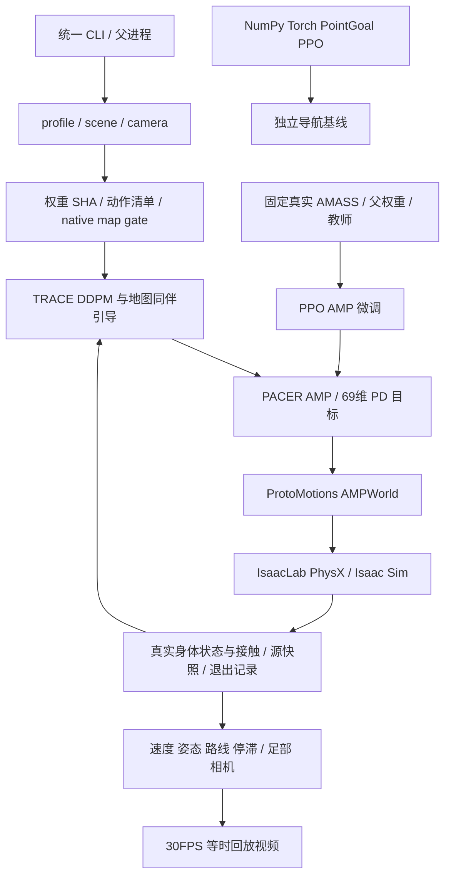

# Architecture
审查：2026-10-10；基于本机文件、安装元数据、AST 和 SHA。此次未启动 Kit、训练或物理重测。完整机器清单见 [inventory.json](../resource_audit_20261010/inventory.json)。

## Core Sections (Required)

### 1) Architectural Style

源码 checkout 驱动的 Python 研究系统：明确的资源/模型合同、模块化算法、父进程管理原生 SDK 生命周期，离线证据核验。主线采用公开 TRACE 轨迹扩散 + 本地 AMASS 微调 PACER/AMP 控制器；独立五状态论文重建模型是另一合同，不能替换为公开TRACE权重后仍声称作者模型。

### 2) System Flow

1. 选择 scene/profile，定位 TRACE、AMP、AMASS manifest 与地图/源码证据。
2. 核对文件身份、场景支持面/路线/地图准入；预检本身不启动 SDK。
3. TRACE 生成轨迹候选，地图/同伴代价、速度转弯约束和显式安全制动筛选。
4. AMP 观测/动作映射进入69DOF身体；IsaacLab PhysX真实推进并收集状态和接触。
5. 父进程保存源代码、配置、输入哈希与实际退出码；离线核验整个30Hz/120Hz记录。
6. 通过质量门槛的源状态用于相机回放录制。视频重播不重新证明机器人闭环导航。

### 3) Layer/Module Responsibilities

| 层 | 模块 / 资源 | 合同 |
| --- | --- | --- |
| 入口 | social_navigation、run_trace_pace_verified | 新输出、子进程归属、真实退出码 |
| 规划 | humanoid/diffusion/planner、raster、guidance | TRACE config/权重一致、世界坐标与地图 |
| 动作 | humanoid/amp/{controller,observations,network} | PACER keys、24body/69DOF、统计和关节排序 |
| 训练 | humanoid/training、finetune_pacer_amass_verified | 真 AMASS、父权重/教师、完整状态与数据隔离 |
| 物理 | amp_world、ProtoMotions simulator/isaaclab | 单独 SDK 环境、真实身体/碰撞/清理 |
| 场景 | runtime/dynbench_scene、native_grid_scene、native_map_v9 | USD/支持面/查询/生成源码身份 |
| 视觉 | smpl_mesh_visualizer、record_pedestrian_coverage | 授权人体参数、物理FK对齐、相机与编码 |
| 评估 | analysis + evaluate/audit scripts | 实际源输入，不把预检/夹具当物理结果 |

### 4) Reused Patterns

版本化 schema；显式 path/SHA；有限数值/关节语义验证；新输出拒绝覆盖；SDK late import；分离父进程 receipt 与子结果；模型候选独立评价。发布资源 verify 检查467文件SHA和14份原始USD gzip，install-models 拒绝覆盖不同文件。

### 5) Known Architectural Risks

native-map、SMPL链接、SDK源码及封存生命周期绑定主机路径；配置搬迁不足以重新准入地图。源码并存公开PACER state-only D与独立 history+action 重建训练；调用入口/模型族必须明确。机器人/FLUX/NavDP与当前四场景行人主链未统一验收；当前视频4/4/1/1人、60秒，未完成论文八场景3–15人200秒协议。

### 6) Evidence

- [实际环境、文件身份、依赖和目录清单](../resource_audit_20261010/inventory.json)
- [本轮四场景预检与发布资源校验](../resource_audit_20261010/resource_checks.json)
- [环境/USD 检查与版本覆盖诊断](../resource_audit_20261010/environment_checks.json)

- [物理入口及明确方法边界](../../scripts/run_trace_pace.py)、[父进程](../../scripts/run_trace_pace_verified.py)
- [TRACE planner](../../src/CrowdSim/humanoid/diffusion/planner.py)、[论文五状态重建](../../src/CrowdSim/humanoid/diffusion/paper.py)、[AMP controller](../../src/CrowdSim/humanoid/amp/controller.py)
- [训练输入冻结](../../scripts/finetune_pacer_amass_verified.py)、[场景 gate](../../src/social_navigation/preflight.py)、[录制入口](../../scripts/record_pedestrian_coverage.py)、[论文方法记录](../diffusion_amp_20261001/paper_method_spec.md)

## Clone portability update — 2026-10-10

The current four-scene flow uses `configs/reproduction/four_scene`, exact in-memory resource bindings, the committed SDK bootstrap/native shutdown bundle, fixed-bank rebuild templates and `scripts/run_four_scene_benchmark.py`. See [clone reproduction](../../CLONE_REPRODUCTION.en.md) and [validation](../CLONE_VALIDATION_20261010.json). Historical experiment receipts remain provenance, not new-run configuration.
