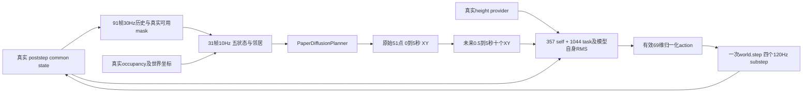

# AMP + Diffusion 接入现有 CrowdSim 的接口计划

2026-10-02；本次完成地图接线修复与 CPU 验证。以下运行时接口为拟实施方案，尚未创建新的驱动或修改冻结的训练业务代码。没有启动 Kit、GPU 或读取封存的 34 条测试捕获。

## 1. 当前入口实际执行什么

| 入口 | 实际链路 | 可复用部分 | 接入限制 |
| --- | --- | --- | --- |
| [CrowdSim.humanoid.simulate](../../../CrowdSim/humanoid/simulate.py) | `build_env → MaskedMimic agent.model → env.step`，报告明确标记 `SFM + SMPL MaskedMimic` | 网格外观、有限运行及捕获检查 | 没有 AMP / Diffusion 分派；默认不传 `scene_physics=True` |
| [CrowdSim.world.builder](../../../CrowdSim/world/builder.py) | 自己创建 AppLauncher、Fabric、MaskedMimic runtime，随后 `nav.attach` | 场景配置加载、资源检查、USD/机器人 SceneCfg 配置 | 不应在已有 AMPWorld 内调用，否则会重复创建 App / SimulationContext |
| [scripts/train_paper_amp.py](../../../scripts/train_paper_amp.py) | 独立真实 PhysX AMP + 五状态 Diffusion，支持训练和评估 | 模型、观测、计划时间、物理循环、真实测量 | 当前共享场景实现是 `ReconstructionScene` 合成障碍；真实 DynBench USD 没有对应 scene / height / contact provider |
| `/project/EXP/NavIsaaclab2.0/CrowdSim` | 原有 MaskedMimic/SFM、共享 USD 与机器人配置 | 场景与机器人组织方式 | 原有导航上下文是 MaskedMimicContext，不是新 AMP 低层控制器 |

旧 `.ckpt + resolved_configs_inference.pt` 与新 `navisaaclab_method_reconstruction_training` bundle 不可互换。仅更改 checkpoint 路径、控制器报告名称或 `nav.attach` 对象，都不能完成 AMP 接入。

## 2. 已修复的地图阻断

四份 `dynabench_*.yaml` 原来引用的外部 `map/occupancy.yaml` 均不存在。现改为仓库内已有的 `data/diffusion_amp/maps_resource_complete/{scene}/occupancy.yaml`。路径仍按 `scene_setup.resolve_repo_path` 的仓库根目录约定解析。

`map_metadata` 原手工逐行解析器会把有效块式 `origin` 读成空字符串。现复用已有 `load_config`，同时接受 PyYAML 块式列表和历史行内列表；无 PyYAML 时，现有 subset loader 会明确拒绝不支持的块式语法，不会静默丢弃坐标。

| 场景 | YAML 原点 `[x,y,yaw]` | 分辨率 | USD / 地图状态 |
| --- | --- | --- | --- |
| Office | `[-24.6,-27.6,0]` | 0.1 m | 本地解析完整；CPU 几何投影地图 |
| Hospital | `[-48.8,-4.9,0]` | 0.1 m | 同上 |
| Warehouse | `[-12.5,-18.5,0]` | 0.1 m | 同上 |
| Full_Warehouse | `[-28.6,-24.0,0]` | 0.1 m | 同上 |

[map_verification.json](map_verification.json) 包含四份实际 USD、YAML、PNG 的路径、大小、SHA256、修复前真实错误和修复后参数。32 份地图 / 预览 / 来源记录逐字节保持不变。**这些仍是 CPU 投影原型，尚未经过真实场景的 cooked PhysX collider 占据验证，不是作者八场景地图。**

40 个 CPU 回归通过，包含实际四图加载、Y 翻转、原点坐标往返、旋转、`negate` 灰度边界和真实栅格中心查询；[测试日志](map_tests.log)、[JUnit](map_tests.xml)、[Ruff](map_ruff.log)。现有训练的 135 文件预启动快照中不含这五个修改文件。134 份当前字节相同；另一个 `docs/.../audit_mixed_actual_checkpoint.py` CPU 工具已有单独后续修改，机器报告保留其前后 SHA，不把当前树声称为整个旧快照相同。

## 3. 最小新增模块与明确选择

建议先新增一个独立部署入口，再给旧 `simulate` 添加启动前的显式分派；旧默认仍保留 MaskedMimic。拟新增 `scripts/run_paper_pedestrians.py` 与 `CrowdSim/humanoid/runtime/{scene_provider,amp_inference,driver}.py`。这些文件尚未实现。

纯配置应要求 `controller.kind=paper_amp_diffusion`、明确 AMP / Diffusion artifact 路径及 hash、scene/map profile、`floor_owner=scene_usd`、控制时钟、碰撞测量和计划执行模式。拒绝未知 kind、错模型 schema、缺失地图或伪造全空白栅格。配置 / 本地文件预检在 AppLauncher 前完成；资源存在并不等于模型架构兼容。

| 拟议接口 | 输入 / 输出 | 实现与边界 |
| --- | --- | --- |
| `SceneProvider.prepare_scene_cfg(base_cfg)` | SceneCfg → 包含一个真实 USD、明确地板和可选一个机器人 | 复用配置对象，通过 simulator 的 `_get_scene_cfg` subclass / factory 注入；避免进程全局永久 monkeypatch |
| `SceneProvider.raster(states)` | 世界 `[B,5]` → `[B,2,224,224]` | 直接复用 [rasterize_navigation_map](../../../CrowdSim/humanoid/diffusion/raster.py) 与 `NavigationTask.world_to_pixel` |
| `SceneProvider.height_at(xy)` / `ground_height_at(xy)` | 世界米坐标 → 同形状绝对世界 Z | 前者供 PACER 头部高度网格，后者供落地、重置、跌倒判定；必须使用不同、明确的碰撞集合 |
| `AMPInferenceController.act(state,targets_xy,height_provider)` | common RobotState + `[B,10,2]` → 有效归一化 `[B,69]` action | 复用现有 `PaperAMPNetwork`、self / task RMS 和冻结手 / 脚趾掩码；不重新训练或改变归一化 |
| `AmpDiffDriver.step_control()` | 读取当前状态 → 一次 30 Hz 控制及状态 / 测量记录 | Sole owner 调用一次 `world.step`，内部恰好四个 120 Hz PhysX substep |

部署不需要创建专家采样索引、训练课程、优化器或 replay buffer。AMASS reset source 的实际姿态与 child-joint 速度约定可保留并显式校验；部署不沿训练 clip-end 自动终止导航任务。

新推理控制器读取 `PaperAMPTrainer` bundle 时，先在 CPU 使用 `weights_only=True` / mmap 校验 schema、TrainingConfig、全部模型键、RMS shape / dtype / finite / nonnegative variance。只构造推理模型、self/task RMS 和 action mask，冻结 normalizer，保留原 checkpoint SHA。通过 CPU 与真实 `PaperAMPTrainer.act(...,deterministic=True)` 的逐输出 parity 后才接入物理。

完整 `PaperAMPTrainer.load(...,restore_rng=False)` 可作为临时正确性 oracle，但仍会构造训练 replay、优化器并初始化 RNG，不是理想部署加载器。公开 `PacerAMPController` 使用另一种 public checkpoint / observation RMS，不能拿它的 RMS 替换已训练 reconstruction 模型。若复用其 actor，`return_raw=True` 后才交给 `AMPWorld.step`；其默认返回已解码 PD target，交给 `world.step` 会重复解码。

## 4. 单 App、单 world 与真实地板

1. 纯 frontend 检查资源和地图坐标。
2. 创建一次 AppLauncher。
3. 构造 scene-aware `PaperPowerSimulator` / AMPWorld 变体，注入唯一 SceneCfg。初始化前设置 `filter_collisions=False` 和全部 24 个 SMPL contact-report body。
4. 一次创建 SimulationContext / PhysicsScene、一次生成所有行人、一个全局 USD；初始化完成后解析实际 native body / collider 路径。
5. 完成一次真实 floor / wall / height readiness probe，再进入 sole driver loop。失败关闭同一个 App，不创建备用 world。

真实 USD 保持原始世界坐标和米尺度，四场景包含负坐标。不能保留现 AMPWorld 正域平面并简单叠加 USD：额外地板会掩盖真实洞、台阶、未加载地板或地图边界。`floor_owner=scene_usd` 时，SceneCfg 禁用额外地形碰撞生成；内部 terrain 元数据若为兼容保留，不得作为实际 ground sampler。reset 的 XY、root Z、所有 body 世界位置、foot support、height query 与导航图必须属于同一个 scene transform。

Provider 显式保存 `floor_collision_paths` 与 `static_obstacle_collision_paths`，从最终 composed stage 的启用 `CollisionAPI` 几何解析，按语义配置分类。Xform 根路径、视觉网格、目录名猜测和 `/World/ground` 固定排除不等于真实 collider。两集合应唯一、互斥；缺地板或未知分类阻断 readiness，而不是返回 0 高度。

当前 `PedestrianContactMonitor` 的静态集合只来自合成 `Obstacle_i`。新 provider 接入需新增显式 exact-static-path 参数，保持原默认，然后使用同一 physics view 的真实 24 body / actor、peer 和障碍矩阵。floor 单独交给已有 `FootCaptureAdapter.from_world(...,floor_roots=...)`，不要把持续脚部支撑算作墙体碰撞。每次控制保留四 substep 的真实 force 与 clock；读传感器不能额外推进物理。

## 5. 高度查询：先实际 PhysX 校验，再批量网格查询

本地 pinned SDK 实际提供 `omni.physx.get_physx_scene_query_interface()`。`_physx.pyi:2149` 定义 `raycast_all(origin,dir,distance,reportFn,bothSides=False)`；callback 包含 `position`、`normal`、`collision`、`rigid_body`。`:2176` 的 `raycast_closest` 返回相同语义的 dict。来源路径及 SHA 位于 [interface_plan.json](interface_plan.json)。本轮只读 binding，没有调用 SDK。

最小原生 probe：在唯一 SimulationCfg **创建前**设置 `enable_scene_query_support=True`，待真实物理初始化，从受控 XY 和覆盖 scene bounds 的高度向下发射 ray；`raycast_all` callback 只保留 floor whitelist 的 hit，按高度 / 向上法线规则选择实际支撑面，记录 hit 的 exact collision path。不能用 closest 任意命中天花板、人体或柜顶当作地面。无需新 SimulationContext；查询应保持现有物理计数不变。

当前 ProtoMotions constructor 没有转发 scene-query flag，需要后续一个默认不变的 SimulationCfg factory / option hook；headless 默认 false，GUI 强制开启不能作为 headless 证明。

性能路径可复用 pinned Lab3 `MultiMeshRayCasterCfg.RaycastTargetCfg`（多 mesh、静态 `track_mesh_transforms=False`、`merge_prim_meshes=True`）或 `isaaclab.utils.warp.raycast_dynamic_meshes`。两者在实际 CPU / GPU mesh device 上批量采样世界米坐标，返回 miss 为 `inf`，必须处理 miss，不能 clamp 成 0。单独 `RayCasterCfg` 的单 mesh 限制不代表此版本没有 MultiMesh 实现。

Warp triangle query **不是 cooked PhysX collider query**。先对 floor、wall、台阶、空洞、地图边缘的 native hits 做路径与 Z 对照，再允许同一 collision-only world mesh cache 加速高度网格。若 USD collision approximation 与渲染 triangles 差异过大，保留 native 结果 / 缓存并报告误差；不要以 visual mesh 命中宣称物理一致。PACER height_at 采样头部附近的顶部障碍表面，排除天花板与动态人体；ground_height_at 仅查询真实支撑地面。跨层场景必须显式层级规则，不能最高点自动当地板。

## 6. 30 Hz driver 的具体数据流

五状态固定为世界 `[x,y,vx,vy,yaw]`。现有 `PaperDiffusionPlanner` 与 TRACE 四状态 unicycle checkpoint schema 不兼容；不要混用状态、标准化或时间间隔。历史为实际 91 帧控制状态取 `::3` 得到最旧到当前 31 帧，reset 只把当前帧标为 available。邻居必须来自同一个共享 scene 的真实世界状态 / 历史，禁止重复填充假的有效邻居。

栅格保留 ROS 下左 cell corner、yaw、行向下与世界 Y 向上的转换；局部 raster 使用 `(col,row)=(12*x+56,12*y+112)`。图外 / unknown 保留 checkpoint 的填充值，并在 route / spawn readiness 中禁止穿越。2D occupancy 不代替 PACER 所需的绝对世界高度。

每个控制步先处理上一次完成步的真实终止与 subset reset，必要时 replan；给 actor 十个未来世界 XY，原协议线性插值与 plan_age / 30 对齐。低层只调用一次 action_to_pd，随后恰好四个 1/120 s 物理步。记录真实 poststep state、所有失败帧及计数，再在下一 control 边界重置；捕获 app update 不得触发额外物理。

可选 `CausalReferenceAdapter` 明确标记为部署适配：原始 51 XY 保留，普通 replan 从当前已执行 reference 状态续接；只有真实 episode reset 从实际 root / velocity 初始化。输出 151 个 30 Hz reference 点，限速 / 限加速度作用于参考而不是物理状态，没有碰撞或稳定性保证。默认不静默开启，不更改历史基线协议。

机器人首轮禁用；随后若启用，建议单个 `/World/CrowdRobot` Articulation 与唯一 robot registry，避免每个 humanoid clone 生成一个机器人。可复用现有 camera mount / actuator SceneCfg；传感器绑定实际 body path。旧 DriveController 是 kinematic root 移动，复用时应报告这个控制语义；动态轮式驱动必须独立证明 actuator / joint-name / dt 契约。不能直接调用 `nav.attach`，它会安装 SFM 和 MaskedMimic context / reset / step 包装。

## 7. 实施顺序与验收

1. 新 SDK-free typed profile / resource gate、推理模型 parity、单步 driver unit contract；默认旧入口行为保持。
2. 新 scene provider 与 scoped SceneCfg injection，明确 floor ownership；少量 native height queries验证 cooked collider 后建立批量查询缓存。
3. 根 agent 运行单 App 两人短场景，核对真实 USD、24/69 name mapping、xyzw、floor / wall / peer contacts、四 substep、真实高度 / 负坐标；此步骤不与训练同时启动 Kit。
4. 同协议四人 200 s 保留所有失败、reset、route、contact / foot / clock、原始与执行参考。`result.status=passed` 仅代表执行和工件完成，独立质量指标决定是否可用。
5. 通过后再加入单机器人与传感器、旧 simulate 的显式 opt-in dispatch；用报告中的模型 schema / checkpoint SHA / planner SHA / scene SHA 证明选用了新链路。

当前该真实 DynBench AMP driver **未实现、未验证**。本次地图 parser / path 修复不改变这一状态；新 mixed 训练的性能仍需其真实完整验证捕获，不能先声称达到论文效果。
