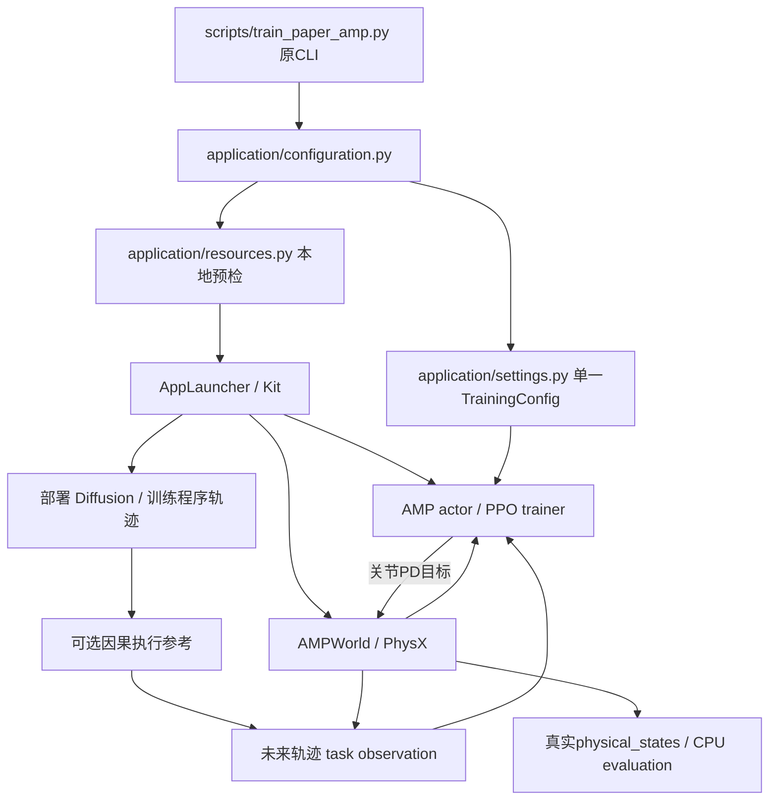

# 当前项目结构、资源入口与物理评估索引

更新日期：2026-10-02（分阶段证据目录保留20261001命名）。本页记录已保存产物与可重复的检查入口；训练以各自 `result.json`、固定 step checkpoint 和日志为准。历史审查、资源及 checkpoint 保留原位置。

最新数据、动作风格、完整动作跟踪与真实地面支撑见 [当前 AMP 改进记录](AMP_STYLE_PROGRESS_20261002_ZH.md)。
v7 的 2,848 段来自 1,853 个真实 AMASS 原动作；反向惩罚模型完成 8,192,000 次状态转换，
完整动作验证 **11/22 成功、零跌倒、位置 0.3007 m、旋转 0.8615 rad**。
四人 200 秒 Diffusion＋AMP 导航零跌倒、21 个顶点到达，24,000 个物理子步的地面力和真实 COM 已独立核验。
速度与路线完成仍有退步，当前不能宣称达到或超过论文。见 [配对训练诊断](style_improvement_20261002/backward_penalty_style_v1/report.md)
和 [200 秒采集核验](style_improvement_20261002/ground_support_200s_actual_verification.md)。

新增分层专家采样的等预算训练已完成，但完整验证为 8/22 成功、两条跌倒，未替换上述基线。
近时域权重的默认兼容路径及联合 596 项 CPU 门禁通过，但四人 200 秒对照为 20 个顶点、两次跌倒，未替换原配置。
[采样效果](style_improvement_20261002/stratified_experts_style_v1/report.md)、
[近时域实现](style_improvement_20261002/near_horizon_waypoint_implementation.md)。

AMASS 原始 XY 课程已通过 643 项联合 CPU 门禁及真实 4+4 GPU 恢复检查，
固定源阶段/平移、30Hz 真实目标和 clip 外工程速度延续分开记录。
全新 1,000 轮训练完成 8,192,000 个物理转换，固定完整验证 **17/22 成功、零跌倒、位置 0.2293 m、旋转 0.8319 rad**。
冻结风格 MMD² 为 0.05607，比负方向惩罚基线的 0.04682 差；速度分布距离改善。
原第 500 轮为 12/22、一次跌倒。新 500→750 续训完整验证为 16/22、两条跌倒，未替换 1,000 轮跟踪候选。
新模型四人导航完整 200 秒为 13 次跌倒、5 个到达顶点，明显退化。独立完整 34 条测试为 11/34 成功、零跌倒。
四人导航基线仍为此前负方向惩罚模型，跟踪改善不能替代新模型的导航验收。
见 [课程实现](style_improvement_20261002/amass_root_curriculum_implementation.md)、
[实际恢复审计](style_improvement_20261002/amass_root_actual_pilot_independent_review.md)。
完整结果见 [跟踪分解](style_improvement_20261002/amass_root_curriculum_tracking_v1/report.md)
及 [冻结风格分析](style_improvement_20261002/amass_root_style_v2/report.md)。

固定 128／128 环境的真实 AMASS／程序导航指令混合课程已通过 700 项 CPU 门禁，
实际 4+4 GPU 训练/恢复和三个随机状态推进已独立核验。
全新 2,000 轮训练已完成，总计 16,384,000 个转换，两个分支各占一半；三个固定检查点均已封存。
最终第 2,000 轮完整验证为 19/22、零跌倒，位置 0.2001 m、旋转 0.7684 rad；整体风格距离仍差于导航基线。
最终模型四人 200 秒导航为 11 次跌倒、19 个顶点、130 个障碍接触 actor frames；
2,259 项测量完整性核验通过，但导航质量失败。第 1,000 轮相同测试已完成：13 次跌倒、15 个顶点、零 static／peer 接触，当前部署基线不变。
[混合课程记录](AMP_STYLE_PROGRESS_20261002_ZH.md#10-固定分槽的-amass导航指令混合课程)、
[原生步态时序](style_improvement_20261002/native_gait_timing_v1/report.md)、
[根轨迹模型完整失败运行视频](../output/diffusion_amp/recorded_amass_root_curriculum_200s_v1/pedestrian_motion.mp4)。

状态与动作判别器的新训练使用独立的 2,019 维 D，不加载公开 state-only D；
真实第 500／1,000 轮完整恢复各通过 1,077 项独立检查；2,000 轮训练已完成 16,384,000 次转换，终态 1,079 项检查通过。完整22条验证17/22、零跌倒；四人200秒导航2次跌倒／2个路径点，低速停留约74%，质量失败。
其源码采用只读字节副本，实际来源账本已记录 86 个隔离项目模块；
[评估预登记](style_improvement_20261002/state_action_evaluation_registration_v1/README.md)固定完整 22 条与四人 200 秒协议。
[AMASS 覆盖审计](style_improvement_20261002/amass_style_coverage_v7_read_only_v1.md)记录短窗快步覆盖及站立／推扰恢复混类风险。

前一阶段的独立低层训练、固定模型与部署命令见 [研究与训练记录](PEDESTRIAN_AMP_DIFFUSION_PROGRESS_20261001_ZH.md)。历史 clean 对照为 11 次跌倒、8 个顶点；旧 319 集模型的单候选定时路线/连续参考四人 200 秒测试为零跌倒、26 个真实顶点及 5 个完整循环。它是新建 fixture 中的单 seed 验证。[前阶段物理对照](amp_improvement_20261001/continuous_timed_physical_comparison.md)。

独立低层训练已完成1,000更新/2,048,000真实transitions；同一controller与Diff5000的原始endpoint测试为3次跌倒、12个真实到达和两个完整循环，static接触/姿态多样性退化。后续连续参考部署另行实测，报告raw模型目标、执行参考和身体运动的不同语义，不把少跌倒单独作为总体通过。[训练审计](amp_improvement_20261001/independent_amp_training_review.md)、[原始路线核查](amp_improvement_20261001/raw_route_completion_verification.md)。

## 项目结构

| 目录 | 职责 | 安装与运行边界 |
| --- | --- | --- |
| `protomotions/` | 通用 agents/envs、MotionLib/PoseLib/SceneLib/terrain、Isaac Lab/Newton/MuJoCo simulator、机器人配置 | 根目录 ProtoMotions wheel 只收录此 Python 包；许可单独管理的 SMPL 资产不随 wheel 发布 |
| `CrowdSim/humanoid/application/` | 无 Torch/Kit 的 CLI、单一 TrainingConfig、profile 校验、本地资源预检 | 当前行人应用来自源码 checkout；不下载资源、不反序列化模型 |
| `runtime/amp_inference.py`、`runtime/checkpoint_contract.py` | 完整 checkpoint 准入后，仅保留 encoder／actor 的冻结推理模型 | 新版actor-only的36项CPU输出一致；实际30秒154个物理／规划／足力字段与旧版及基线前缀逐位一致，203项原始测量检查通过 |
| `runtime/evaluation_actor.py`、`runtime/arm_style.py` | 不构造训练器的统一 actor；显式可选腕臂风格实验 | 基线与 donor alpha0 的真实30秒物理／规划／足力逐位一致；原生alpha=.25实际30秒0跌倒／8顶点，风格与速度指标互有退步，未升级默认 |
| `runtime/dynbench_scene.py`、`runtime/native_grid_scene.py` | 原始 USD session、有限参考地面、保守栅格 A*、可微 SDF、坐标准入 | 不创建第二个 App／Context，不修改源 USD；unknown／域外均阻挡，格点代理不冒充原生接触距离 |
| `application/native_deployment.py` | 无 SDK 的原生场景配置／资源 SHA 门禁及延迟 factory | `--native-dynbench --inference-only` 接入既有控制循环；Warehouse 四人200秒零跌倒／零接触、57顶点／12循环、983项原始核验；15人200秒实测零跌倒／零接触、211顶点／49循环，1,325项全量核验通过 |
| `application/native_scene_preparation.py`、`scripts/prepare_native_pedestrian_scene.py` | 已准入地图的确定性出生点、路线和 CPU 证明 | 支持3–15人、出生间距至少1.6m；旧4／15人坐标逐位复现，A*通过不代表物理质量 |
| `CrowdSim/humanoid/diffusion/` | 五状态轨迹扩散与显式 guidance 变体 | 输出局部五秒轨迹；训练、部署模型与 guidance 参数各自记录 |
| `CrowdSim/humanoid/waypoint_weighting.py` | 无 Torch/Kit 的可选近时域目标系数及校验 | 参数 0 保留原均值；加权仅用于显式部署实验，梯度与过滤一致 |
| `CrowdSim/humanoid/amp/` | PACER 观测、SMPL canonical 映射、参考网络与严格权重加载 | 公开 PACER 是参考控制器；作者 NavIsaacLab 定制权重仍未取得 |
| `CrowdSim/humanoid/training/` | Torch PPO/AMP、reward、程序轨迹课程、因果执行参考、完整 optimizer/RNG/normalizer checkpoint | `trainer.TrainingConfig` 重导出 application/settings.py 的同一类；程序课程用于独立低层训练，参考适配只用于显式部署 |
| `CrowdSim/humanoid/amp_world.py` | 24 body/69 DOF、120Hz PhysX 与 30Hz 控制、真实训练状态 | Kit 启动后导入；不使用 MaskedMimic 驱动新的 Diffusion+AMP 训练 |
| `CrowdSim/humanoid/amass_corpus.py`、`training/amass_curation.py` | 原动作来源、真正重采样/中性 FK、显式关节速度坐标、参考状态 | v7 数据供 AMP；保留 legacy 模式以复查旧模型；不是作者未公开动作清单 |
| `training/replay.py`、`symmetry.py`、`expert_sampling.py` | 原始策略历史回放、有效坐标镜像、独立短窗专家概率 | 采样器支持完整来源/概率/RNG；新采样训练单独作为实验，不预先声称效果 |
| `training/amass_trajectories.py` | 可选真实 AMASS 根 XY 指令与固定阶段/平移课程 | `--trajectory-source amass_root` 仅训练；原帧目标不重锚，clip 外延续非真实未来姿势，末帧截断；部署仍用 Diffusion |
| `training/mixed_trajectories.py` | 固定环境分槽的 AMASS／原程序指令课程，分别保存分支计数、阶段和三组 RNG | `--trajectory-source mixed_amass_procedural` 仅训练；当前 128／128，单一策略不接收分支标签 |
| `motion_tracking.py`、`style_evaluation.py` | 完整动作失败判定与冻结速度分层风格指标 | 只读已保存物理状态，不用目标姿势逐帧控制行人；本地 MMD² 非作者数值的直接复刻 |
| `CrowdSim/humanoid/contact_monitor.py` | exact-path 身体—障碍/身体—其他行人的过滤法向接触力 | 当前 native view 按 actor 批量24个身体；保留显式逐身体模式及严格 shape 校验 |
| `physics_views.py`、`foot_support.py`、`foot_capture.py`、`ground_support_archive.py` | 当前 Lab 世界视图所有权、足地法向力、真正 COM、四子步独立档案 | `--measure-ground-support` 仅用于显式评估；身体原点切向速度为代理，没有补造原生接触点速度 |
| `CrowdSim/world/`、`nav_manager.py`、`control/`、`ppo/` | 原 robot navigation、SFM/MaskedMimic、地图及机器人 PPO | 保留原入口与配置；行人新方法的结果独立保存 |
| `src/crowdsim_ppo/` | 可单独安装、无模拟器的 PPO 参考环境与 CLI | `pip install ./src`；不提供 SMPL PhysX 仿真 |
| `configs/diffusion_amp/` | 方法重建、独立低层课程、state-only PACER adaptation、严格作者实验、共享验证场景 | YAML 指定算法/初始化合同；未知 training 字段立即报错 |
| `scripts/` | 数据准备、训练、诊断、资源解析/地图生成、CPU评估入口 | `train_paper_amp.py` 保留现有 main 和 flags，通过薄 parser shim 调用 application |
| `scripts/replay_paper_pedestrians.py` | 已保存物理姿势的独立SMPL视觉回放 | 强制回放标识/源hash/固定时间线；原生室内450帧30秒回放已完成且可见人物，媒体/源hash/时钟核查通过；不作新的策略、物理接触或导航验证 |
| `scripts/simulate_paper_pedestrians.py` | 显式 AMP＋Diffusion 薄入口，复用现有 sole evaluator | cuboid 原／纯推理／alpha0 实际30秒逐字段前缀对照通过；原生USD单世界四人200秒已完成：0跌倒／57顶点／12循环／0接触，983项原始核验 |
| `scripts/probe_paper_scene_maps.py` | 四 DynBench 场景的原生 PhysX 占据与地面支撑探针 | 真实v7 Warehouse／Full Warehouse已准入；Office／Hospital在查询时钟−1/60s失败并保留实测；v8合并后226项CPU通过；真实Full Warehouse准入，另三场景source root RAM范围被改而拒绝，v9匿名运行根层已合入并通过270CPU，真实四场景资源门禁全部通过，独立4441项raw复核通过，547321原生格点；48份配置的2058条A*连接通过，Hospital12–15布点拒绝 |
| `data/` | supplied 数据清单、外部权重、SMPL/UV/纹理及 scene resources | 资源未变成 wheel 内的虚构替代；AMASS 大包仍在相邻 Assets |
| `env/isaaclab3_sim6/` | 经过验证的 Python3.12 / Sim6 / Lab3 依赖锁与环境检查 | Lab 产品3.0.0、包12.0.0、commit4ecd0b；详见原环境说明 |
| `docs/`、`output/` | 分阶段证据、固定 checkpoint、真实状态/视频及指标 | 比较固定 step 文件的 SHA；可变 `last.pt` 仅作恢复入口 |

根 `pyproject.toml` 的 `[crowd]` extra 提供源码应用的附加依赖，不把 `CrowdSim` 或大数据集装进 ProtoMotions wheel。源码路径外的运行需要部署源码应用、配置与显式资源目录。[环境说明](../env/isaaclab3_sim6/README.md)、[发行工件验证](completion_20261001/release_artifacts_final.md)保留完整边界。

## AMP 启动顺序



本轮提取配置、参数与资源预检；模拟器 main 仍由现有入口管理。共享物理、规划时钟、训练恢复的复杂状态没有搬到第二份 runner。新模块和原入口的静态导入、真实本地 preflight 均验证没有导入 Torch、Isaac Lab、Isaac Sim、Omni、Warp、pxr。[真实三配置预检](structure_optimization_20261001/actual_resource_preflight.json)。

### 启动 Kit 前检查

从源码根目录使用已验证的 Python：

```bash
../IsaacLab-Protomotions/.venv/bin/python -m CrowdSim.humanoid.application.preflight \
  --config configs/diffusion_amp/method_reconstruction.yaml \
  --diffusion-checkpoint output/diffusion_amp/diffusion_training/step_1000.ckpt \
  --output output/diffusion_amp/PREFLIGHT_NEW_RUN
```

这个命令使用真实 runner 的 CLI 校验与资源 registry，返回 JSON，且不会创建 Kit、训练或覆盖输出。必须选择尚无运行工件的输出路径，保持原 runner 的覆盖保护。需要纯随机初始化时明确加 `--from-scratch`；`amp_pacer_adaptation.yaml` 宣告完整公开 D 初始化，不能与 `--from-scratch` 同用。

- CLI 的 config/manifest/checkpoint/output 相对路径仍按 **cwd** 解析。manifest 内的相对 `.pt` 路径按 **manifest.parent** 解析；真实 mmap 回归证明 cwd 存在同名不同数据时也不会误加载。
- `PROTOMOTIONS_ASSET_ROOT` 管理 rig 来源；capture 尊重已有 `CROWDSIM_SMPL_MODEL_DIR`，支持显式模型文件、`smpl/SMPL_NEUTRAL.pkl` 或平铺文件。
- profile 字段类型/范围、CLI seed、SMPL world 的30Hz/五秒/10历史帧合同、split身份泄漏、LFS pointer、文件尺寸、scene点/box元数据都在 SDK 前检查。
- 每次重新核验选中的公开 PACER SHA。AMASS 的大文件仅核对 stat/尺寸并携带已有声明 SHA，不把它写成重新完成的内容 hash。
- `--deterministic-evaluation`仅允许评估；cuBLAS环境只读预检，在runner启动SDK前设置已验证值。严格Torch算法、实际数值开关和截图状态诊断单独记录；不承诺PhysX/Warp逐位一致。Sim6缺失的原生时钟API报告不可观测。
- Torch ZIP/pickle **签名**不是架构或内容验证；完整 tensor ID、24 body/69 DOF、checkpoint state_dict、numeric SMPL/UV、FK、render 仍经过各自真实加载检查。可选纹理 presence 仅表示有文件，不证明 UV 对齐或图像可解码。

## 当前资源入口

| 资源 | 当前路径/状态 | 证据与限制 |
| --- | --- | --- |
| AMASS train/validation/test | `../Assets/motion/amass_smpl_{train,validation,test}.pt`；本地可读 | manifest选择319/22/34，不是作者2,848；[实际库验证](diffusion_amp_20261001/amass_corpus_verification.json) |
| 当前 AMASS v7 训练集 | `data/diffusion_amp/amass_style_2848/manifest_labeled_v7.json` 及同目录训练 `.pt` | 2,848 个非重叠真实片段/1,853 原动作；原 22/34 保留集不变；[v7 验证](amass_curation_20261002/verification_v7.json) |
| 当前 neutral SMPL physics rig | `protomotions/data/assets/mjcf/smpl_humanoid.xml` | [2047帧骨架/FK一致性](diffusion_amp_20261001/amass_rig_consistency_review.md)；动态稳定性单独评估 |
| SMPL visual model、UV与纹理 | `data/smpl/SMPL_NEUTRAL.pkl`、`smpl_uv.npz`、`textures/` | [安全模型/纹理 CPU 验证](resource_completion_20261001/smpl_textured_cpu_verification.json)；neutral来自已供本地模型，授权/许可不因链接改变 |
| 公开 PACER | `data/pretrained_models/paper_references/pacer/output/release/pacer_no_shape/Humanoid.pth` | SHA `bc0cb89b…`，119,755,239 bytes；[数学一致性与严格加载](diffusion_amp_20261001/pacer_cpu_verification.json) |
| 本地训练 Diffusion/AMP | `output/diffusion_amp/*/step_*.{ckpt,pt}` | 实际训练产物，各实验保留独立配置/来源；定制 author weights 仍未取得 |
| 四 DynBench USD | 原 Assets 的 Full_Warehouse、Warehouse、Office、Hospital | [资源闭包与纹理/MDL检查](maps_projection_resource_complete_inventory.md)；不等于作者八场景清单 |
| 四 occupancy 图 | `data/diffusion_amp/maps_resource_complete/<scene>/occupancy.{yaml,png}` | 正确米尺度、负坐标 origin/Y翻转；当前为 CPU 几何投影 prototype，尚非 PhysX collider-verified author map |
| 两 HDR | `data/scene_resources/hdri/{abandoned_parking,sunflowers}_4k.hdr` | [官方来源、CC0、真实 hash](resource_completion_20261001/hdri_download_manifest.json) |

旧 `full_audit_20261001` 和早期 `local_resource_plan` 是当时状态；后续真实资源验证与链接记录构成当前证据，不能继续据旧快照断言现有 UV、纹理或 Forklift/KLT 缺失。完整官方下载、mixed-source normal map 与外部相对链接见[链接记录](diffusion_amp_20261001/scene_resource_links.json)。没有移动历史 USD、FLUX、NavDP 或旧模型权重。

## 已有物理评估能说明什么

| 已保存实验 | 实际任务/时长 | 跌倒结果 | 可确认结论 |
| --- | --- | --- | --- |
| 首轮旧错时功率 / corrected endpoint / corrected timed | 同一新建共享 obstacle fixture，4人各200s，单seed；Diffusion+AMP | 三轮均16次；16/20 observed episodes=80%，4/4人至少一次 | timed到达2个route顶点，仍未稳定；[完整三轮比较](diffusion_amp_20261001/physical_evaluation_comparison/report.md) |
| bounded flat V2：公开 PACER / corrected AMP1000 | 32个隔离actor、50s、解析直线路径、348m地形；无 Diffusion | 两者0/32 fall，最低pelvis分别0.8055/0.7007m | 当前 rig+PD 支持这一低层直线条件；[实际结果](../output/diffusion_amp/controller_flat_diagnostic_bounded_v2/result.json) |
| ContactV4逐身体 / V5批身体探针 | 两人、主动制造 floor-only/wall/peer 条件 | 接触通道专项测试，不评导航 | 两版 floor 0，wall10492.528N，peer1376.634N双向、self0；[V5](../output/diffusion_amp/contact_sensor_probe_v5_batched/result.json) |
| 独立AMP1000＋Diff5000：raw endpoint | 四人各200s，新建共享fixture，seed7 | 3次 | 12实际到达/2循环，static7%；[对照](amp_improvement_20261001/independent_amp_physical_comparison.md) |
| 同模型：单候选 timed＋causal reference | 同一fixture，四人各200s，seed7 | 0次 | 26实际到达/5同episode循环，static3.85%/peer0；[完整报告](amp_improvement_20261001/continuous_timed_physical_comparison.md)，仍非八场景/风格通过 |
| v7 反向惩罚 AMP1000＋Diff5000、真实地面采集 | 同一新建 fixture，四人各200s，seed7、严格 Torch 模式 | 0次 | 21 顶点/4 循环，static/peer 0；完整 24,000 子步、真正 COM 与足地力，[独立核验](style_improvement_20261002/ground_support_200s_actual_verification.md)；慢速停留增加，非整体质量通过 |
| 记录姿势回放 | 上一行物理记录的200s、3000帧/15fps、1280×960 | 不产生新的跌倒评估 | [回放视频](../output/diffusion_amp/recorded_pose_replay_200s_v1/pedestrian_motion.mp4)与[实际核验](amp_improvement_20261001/recorded_replay_actual_verification.md)；每帧永久标明来源，physics/policy steps均0 |
| 严格Torch模式：无渲染/实际渲染 | 相同源码/模型/seed7，分别四人30s；渲染450帧/15fps | 两次均0次 | 全部保存状态/参考数组逐字节一致，450截图诊断不变；2实际顶点/0循环，static8.75%/peer0.50%；[核验](amp_improvement_20261001/deterministic_render_pair_verification.md)，不保证200s或跨平台一致性 |

bounded V1 的部分自由落体发生在64m有限地板边缘；V2扩大真实地板并调整 spawn。V1/V2第一个 reset 的 RNG 消费不同，初始参考帧不是跨版本完全配对；**V2 内两控制器的初始状态相同**。共享200s实验的真实跌倒发生在有界内部，不能用旧 flat 的地板边缘原因解释全部共享场景跌倒。零跌倒直線诊断也不能代替共享导航、避障或八场景复现。

历史三轮200s没有记录实际 pairwise contact，root-point/map、0.3m agent-disc 数据只能叫几何代理；新探针通过不会补造历史接触数据。新结果使用固定step文件、完整物理状态和完成后的报告；不从可变`last.pt`或未完成的结果推断提升。历史普通模式单/双候选重新渲染短跑均出现一次跌倒，[两份视频核验](amp_improvement_20261001/render_capture_verification.json)。后续严格Torch模式的同源码渲染/无渲染30秒对照均零跌倒且记录一致；200秒零跌倒结论仍对应原无渲染物理run，不是重新执行的渲染策略验收。

## 新接触指标与验收合同

Isaac Lab官方文档区分 aggregate/filtered **法向**力和摩擦力；PhysX aggregate不提供完整摩擦分量，filtered矩阵按目标filter记录。高层 `ContactSensor` 有一个source body/environment 的过滤限制，不能直接据此推断 native exact-path batch可用；这里以 pinned SDK实际矩阵与V5 PhysX探针验证原生按actor24身体分组。[官方 Contact Sensor 文档](https://isaac-sim.github.io/IsaacLab/v3.0.0-EA/source/concepts/sensors/contact_sensor.html)。

新本地定义：每个30Hz控制步，采样四个已结束的120Hz物理子步；对 source-body/target-body 法向 resultant 的3D范数取最大，再与 **strict > 1N** 比较。障碍筛选真实 `CollisionAPI` 子prim，包含实际 `/geometry/mesh`，排除floor、自身articulation；输出 static `[B]`、peer `[B,B]` 和对应峰值N。它不是摩擦力、接触点数量、几何穿透深度或作者未给出的“collision rate”同义定义。原生contact buffer容量显式记录；接触密集场景仍应核查容量/覆盖，不能把探针当任意密度的完整性证明。

新的验收产物应同时保存：

1. 固定模型/数据/rig/physics/scene/config SHA、seed与30/120Hz合同；相同初始状态的基础控制器对照及多个seed。
2. 全部 actor/frame 状态、真实 fall与reset/episode ID、终止原因和 time-limit/right-censored分母；分开报告事件数、跌倒actor比例、episode比例及actor-seconds。
3. 全局 route顶点/最终目的地达成、实际物理路径与同刻local tracking；A* query失败/合法connector恢复不充当成功率或物理teleport。
4. 精确身体/障碍filter、120Hz采样计数、所有substep峰值、严格阈值的 static/peer mask及事件；几何代理保留独立字段，接触缺测保留unknown。
5. 固定AMASS参考拟合的同一K50/K100中心、明确数据split和pose/MMD合同，以及开环扩散ADE/FDE/scene/peer collision与闭环物理效果；低 MSE或高姿态coverage单独不能证明稳定导航。
6. 首中尾RGB、完整MP4、controller/模型加载与训练实际transition数、checkpoint/RNG恢复证据。

这些是可执行的本地验收合同。作者八场景/2,848清单、定制权重及完整指标分母仍未公开取得；当前不能给论文数值等价结论。

## 前阶段验证（20261001，历史快照）

- 核心20份测试文件最终合并验证 **463 passed**；训练与模拟器分离的接口、物理奖励、引导、课程、参考、路线、评估、记录回放与确定性诊断合同见[最终日志](amp_improvement_20261001/final_core_tests.log)。核心修改Ruff通过。这与以下110项专项记录存在重叠，不将二者相加报告总数。
- 三个新文件集中测试共 **110 passed**，CPU、`CUDA_VISIBLE_DEVICES=''`；覆盖纯导入、真实 Torch mmap 路径、配置/资源失败、19个数值参数的38个boolean误用，以及真实 Warp CPU force-buffer 聚合。[日志](structure_optimization_20261001/focused_tests.log)、[JUnit](structure_optimization_20261001/focused_tests.xml)。
- 两个实际训练 profile及capture共享评估 profile的当前文件预检全部通过；没有创建SDK、导入重模块或反序列化模型。[JSON](structure_optimization_20261001/actual_resource_preflight.json)。
- 本轮修改文件的 Ruff Python3.12 gate通过；before副本与最终文件hash见[结构调整记录](structure_optimization_20261001/resource_structure_changes.json)。
- 前阶段业务代码/配置/测试共75文件冻结于[清单](amp_improvement_20261001/final_runtime_source.json)。源码发行包必需路径、代码和指南通过快照检查，权重与授权模型不包含在包内；见[最终打包报告](amp_improvement_20261001/packaging_source_snapshot_v4.md)。旧包及其指南后续更新记录作为历史证据保留。当前新增动作风格、采样及地面采集的门禁与源版本另见 [20261002 改进记录](AMP_STYLE_PROGRESS_20261002_ZH.md)。


## 新增风格诊断入口

- [15关键点45D姿态覆盖／熵／距离](style_improvement_20261002/pose_diversity_candidate_v1/README.md)：与历史90D评价分别记录；所有合法区间保留失败帧，作者指标核与完整协议仍未知。
- [原生腕臂alpha=.25同900帧](style_improvement_20261002/native_arm_alpha025_30s_style_v1/README.md)：MMD略降，速度W1与K100覆盖率略退，30秒试验不替换基线。
- [地形统计与已保存导航重建](style_improvement_20261002/navigation_terrain_rms_review_v1/README.md)：平地输入稀释1024维统计；历史报告用保存状态重建。后来已补充[真实pre-action采集](style_improvement_20261002/pre_action_actual_observation_reader_v1/README.md)：30秒中地形裁剪率1.677246%，不据此断言停滞原因。
- [历史174文件运行源](style_improvement_20261002/native_runtime_epoch_v7/native_pedestrian_source_v7.json)：四图V9、室内回放及15人200秒使用该封存；[V9阶段生产181文件](style_improvement_20261002/native_runtime_epoch_v9/native_pedestrian_source_v9.json)补充观察器与统计保护。独立训练另用931文件来源账本，旧实验保留历史源；选定文件快照不是全部执行导入账本。


## 原生场景当前交付

[四场V9全量独立审核](style_improvement_20261002/native_map_v9_four_scene_independent_review_v1/README.md)、[48份保守配置及拒绝记录](style_improvement_20261002/native_map_clock_v9_actual_reader_preparation/actual_four_scenes_v1/report.md)、[室内30秒回放](../output/diffusion_amp/native_warehouse_recorded_replay_indoor_30s_v1/pedestrian_motion.mp4)及[媒体/来源核查](style_improvement_20261002/native_recorded_replay_reader_v1/README.md)。地图准入、CPU路径、闭环物理质量、视觉可见性和动作风格使用各自的真实证据。

## 策略输入观察与独立统计保护训练

`runtime/pre_action_observation.py` 和 `scripts/probe_paper_pre_action.py` 在原actor执行前采样输入，在act返回后、物理step前落盘；不创建第二控制循环。实际30秒观察的全部物理／参考／支撑数组与旧基准逐字节一致，地形裁剪率1.677246%，轨迹前20维零裁剪。[真实观察审计](style_improvement_20261002/pre_action_actual_observation_reader_v1/README.md)。

`training/terrain_statistics.py` 是显式新训练策略，严格绑定公共PACER地形moments及完整checkpoint状态；`settings.py`选择模式，`trainer.py`执行统计更新与保存／恢复，`checkpoint_contract.py`和`amp_inference.py`做推理入场校验。生产181文件封存、165CPU／Ruff通过；实际训练另用旧926＋统计delta的931文件独立副本。实际4＋4恢复通过1,150项全状态核验；新2,000轮训练实际完成16,384,000转换，终态2,046项检查通过。完整22条跟踪15/22成功、零跌倒、位置0.247776m／旋转0.775494rad；相对旧同预算state-action模型的跟踪退化，四人200秒导航实际零跌倒／零接触、25路线点、93.8667停滞人秒，但90D风格MMD²0.09013555劣于基线0.07238060，固定45D覆盖亦下降；未满足原生场景后续风格门，默认模型保留。[实验登记](style_improvement_20261002/terrain_protected_experiment_registration_v1/registration.json)。

[已完成的SMPL蒙皮保真核验](style_improvement_20261002/recorded_smpl_skin_audit_v1/README.md)确认现有recorded replay为纹理SMPL LBS，不是物理胶囊显示替代。全部900×4帧的关节最大位置差0.23931mm；碰撞、足部滑移和动作风格仍分别验收。新统计保护训练step500与step1000阶段各2,042项通过，完整step2000终态2,046项通过；状态准入与效果评价分开。

## 当前入口与源码发行包核验（20261003）

[实际结构审查](current_structure_review_20261003/README.md)完成六项SDK-free资源预检和89个本地链接核对；v7的2,848段／1,853父动作、22验证／34测试的完整metadata及父源隔离不变。教程用显式新清单和新训练目录，后续AMP引用训练器实际生成的`last.ckpt`。

`MANIFEST.in`精确补入九个当前行人入口／数据工具和本动作风格指南。[/tmp隔离实际源码构建门禁](current_structure_review_20261003/packaging/sdist_verification.json)验证26个必需路径与字节摘要；解包后的help与保护统计profile可用，原egg-info不改。外部权重、AMASS数据、USD场景和受限SMPL模型不在发行包中；这不是新增资源下载或GPU效果证明。

[地形统计保护完整导航与风格结果](style_improvement_20261002/terrain_protected_navigation2000_complete_review_v1/README.md)与[打包规则后181来源V10](style_improvement_20261003/native_runtime_epoch_v10/native_pedestrian_source_v10.json)已保存：V10仅MANIFEST.in变化，其余180运行文件与V9逐字节相同；旧931训练／评估源不变。

## 公共动作风格先验初始化：V11（20261003）

[生产183文件来源](style_improvement_20261003/native_runtime_epoch_v11/native_pedestrian_source_v11.json)相对V10仅4个原有实现文件、1个运行器测试fixture改变，新增初始化合同与可选profile两文件；其余176父文件字节不变。旧931训练源及六份数据／权重输入指纹不变。新trial另冻结934文件来源，避免带入无关native/adapter变更。

[合并后44＋224测试与预检](style_improvement_20261003/merged_action_state_prior_CPU_v1/README.md)通过；实际pilot4已关闭并封存32,768转换。恢复验证与完整训练／效果评估仍待完成，默认部署模型保持原step1000。
