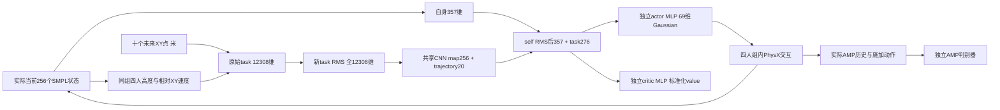

# 社交 AMP 接入合同：从已完成几何到真实共享训练

本页把已有独立组件的输入、网络和物理边界连起来。本页是合同；[独立fresh训练入口](../shared_social_training_entry_staging_v1/README.md)已完成可调用源码和两份配置，**尚未启动或验证实际训练**。正式 Diffusion 40k 会话50502尚在运行；本轮不并行启动网络构建、权重加载、SDK或GPU工作。生产185源码与既有默认模型保持原身份。

已落地组件：[NumPy几何参照](../social_raster_staging_v1/README.md)、[Torch栅格](../social_raster_torch_staging_v1/README.md)、[raw task组装与镜像](../social_task_observation_staging_v1/README.md)、[四人组reset掩码](../social_group_reset_staging_v1/README.md)、[独立社交CNN网络类](../social_policy_staging_v1/README.md)。前四者分别通过4／7／4／5项实际有界CPU检查；网络类只经过compile／Ruff／源码审阅，三项NN测试仍未执行。文件／检查身份详见各入口，不把它们合并称为已完成的共享训练测试。

进一步已实现[四articulation场景配置factory](../group_articulation_scene_staging_v1/README.md)、[四组buffer与canonical actor行的双向桥](../group_articulation_tensor_bridge_staging_v1/README.md)、[社交训练配置与新特征校验](../social_training_settings_staging_v1/README.md)。分别通过2项stdlib配置mock、5项CPU Tensor排列、4项stdlib配置检查，并经独立审阅后封存。factory未实际调用SDK，bridge不做COMMON／SIMULATOR body／DOF／quaternion转换；配置没有构建新trainer或读取权重。SDK接线及真实共享物理仍未成立。

新[状态读写适配器](../group_articulation_state_adapter_staging_v1/README.md)已补身体／关节名称的COMMON转换、当前link属性快照、缓冲PD位置目标与全组部分reset。5项fake-asset CPU检查实际通过，未调用SDK。新[八人／两组物理检查入口](../group_articulation_physics_smoke_staging_v1/README.md)只经compile／Ruff和源码审阅：同组正接触、跨组原始力严格零、实际接触路径与两阶段32子步均需未来真实执行确认。两项源由root 6e49d6封存；它们仍不构成共享训练已运行的证据。

[完整raw self／task／action镜像](../social_symmetry_staging_v1/README.md)的4项CPU张量／梯度检查已实际通过。新[社交CNN／PPO／AMP训练器](../social_trainer_staging_v1/README.md)已把新factory、D2019、四RMS、原PPO更新的镜像入口及新checkpoint schema连接源码，root e63cce封存；只经过compile／Ruff、明确派生逆bytes／AST及独立审阅，尚未导入或执行NN。神经网络运行、resume、真实物理驱动和训练均未完成。

新增[共享物理驱动](../shared_group_world_staging_v1/README.md)、[rollout采样循环](../social_rollout_collector_staging_v1/README.md)与[冻结可微critic](../social_value_adapter_staging_v1/README.md)均已完成独立源码审阅、compile／Ruff及root0780fd封存，尚未执行NN或SDK。World连接四子步、当前法向力、末态next value消费和全组历史reset；collector保存原PPO／D动作与时序；value接口固定当前self／raster，仅改变local20轨迹。三项grid声明强制与训练配置一致，声明不等于实际几何证明。四项fake-boundary CPU driver检查已实际退出0/.207秒；另四项collector检查实际8dd007退出0/.034秒，覆盖完整奖励／末态nextV／RMS冻结及失败保留。两组检查分别封存；不构成SDK物理结果。[原生net-normal view工厂](../social_normal_force_view_factory_staging_v1/README.md)已源码接线并通过3项stdlib模拟检查；[AMASS专家批次](../social_amass_expert_staging_v1/README.md)已复用原采样／动作代理并通过4项合成CPU检查。实际view创建、真实专家与训练循环尚未验证；完整CLI已另补独立源码，Diffusion deployment和物理checkpoint恢复仍未完成。

[八人共享World真实SDK探针](../shared_group_world_SDK_probe_staging_v1/README.md)已完成源码审阅、compile／Ruff及root1f82af封存。它连接真实train2848、原mixed命令、四articulation、原生normal views和reset前归档，默认8个控制步；尚未执行SDK。[新共享训练CLI](../shared_social_training_entry_staging_v1/README.md)已完成源码／配置审阅与rootaa119d封存，尚未执行；零动作／合成nextV探针不能替代真实NN、专家采样、PPO更新和物理质量验证。

[独立社交actor推理](../social_deployment_integration_v1/README.md)已完成from_trainer快照源码、compile／Ruff、独立审阅及root6e22a2封存，仅保留已训练encoder／actor／self+task RMS／57mask，支持B1或B4；未执行NN。独立[checkpoint reader](../social_checkpoint_inference_staging_v1/README.md)另已完成严格加载源码、compile／Ruff及审阅封存，尚未加载实际权重；[同帧观察producer](../social_evaluation_observation_staging_v1/README.md)和[全22单人跟踪入口](../social_tracking_evaluation_staging_v1/README.md)源码已审阅封存，[四人200秒入口](../social_navigation_evaluation_staging_v1/README.md)源码已审阅封存；均未实际执行，native接线仍待实现。原1044入口不能只换checkpoint直接复用。

新trainer的四项合成CPU NN测试已写出、独立审阅并由root27cb66封存，但尚未执行。旧三个policy NN测试也未运行；CPU primitive检查与新驱动静态检查不能充作训练或恢复成功。

## 源码确认的问题

既有登记的q训练使用256个单人隔离环境；`scripts/train_paper_amp.py` 默认64个，实际数量由`--num-envs`指定。`shared_world`只随evaluate开启；`AMPWorld`还拒绝mixed／AMASS curriculum与shared模式同时启用。357维self只有自身身体，1044维task只有20轨迹坐标＋32²静态高度。Diffusion虽有peer历史，现有AMP的actor／critic看不到动态peer高度和速度。既有50系数镜像正则已经实现，不能把它称作缺失。

把`num_envs`改成64、关闭所有collision filtering或仅把`task_dim`改成12308，都不能完成四人分组训练：前两者分别只有64人、或允许不同组互相碰撞，第三者还会遇到旧mirror、网络factory、normalizer与checkpoint约束。

## 数据流与尺寸

| 边界 | 明确合同 |
| --- | --- |
| 扁平actor行 | 256行；前128 AMASS、后128 procedural。第g组为`[2g,2g+1,128+2g,129+2g]`，共64组。稳定actor身份与存储行号分别管理。 |
| 原始task前缀 | 十个`+0.5…+5s`未来XY位移，root projected-X heading坐标、单位米，20维，**没有额外乘10**。提供者负责同一实际obs时刻的采样；组装器不推进clock。 |
| 原始task后缀 | 栅格`[64,64,3]`按HWC展平，ij轴为X/Y。三通道为高度、相对Vx、相对Vy。包含哪些actor、grid center／heading和reference Z必须显式提供。 |
| 社交几何 | [Torch栅格](../social_raster_torch_staging_v1/README.md)采用4m×4m、固定0.5m×1m footprint、staticZ＋1.7m一次叠高，scene限制、最近root归属及stable-ID精确tie；channels先clip±3再乘5。它是明确的本地中性SMPL适配。 |
| normalizer | raw self357与raw task12308在rollout与对应PPO更新间冻结同一moments。task全部坐标进入新RMS；旧1024 terrain protected suffix不能复制。栅格标准化后进入CNN，不还原物理单位。 |
| task encoder | HWC→NCHW；三个Conv2d16、k4/s2/p1/ReLU，64→32→16→8；flatten1024→512→256，输出`[map256, normalized trajectory20]`共276维。 |
| actor／critic | self357＋task276＝633；共享一个实际task encoder，独立633→2048→1024→69／1 MLP。Gaussian固定log_std−2.9；网络的value是标准化标量。 |
| AMP判别器 | 社交task不加入D。195×10＝1950历史state；Nav式2的动作条件另加实际施加69维动作＝2019。state-only消融必须独立命名，不冒充Nav式2。 |

旧1044-task模型、613首层、旧moments、部署loader不能整模型复用。新schema、network factory与strict trainer admission已写独立源码；实际运行验证和inference入口仍需接入。独立新网络的默认初始化也不等于已经训练好；未来若部分迁移，必须按明确命名的参数块、维度及moments逐项审核和记录，不能用`strict=False`隐藏缺失。当前新trainer只允许fresh initialization；state-only及旧warm-start权重均不能隐式进入。

## 物理与reset顺序

未来SDK实现应实际创建64个环境、每个环境四个SMPL articulation，保留**组内**碰撞并过滤组间碰撞。256行逻辑状态、69维动作及curriculum索引需要与四个articulation的64行物理buffer双向映射。只写scene ID不会创建该物理布局。

控制步保持120Hz物理、四子步／30Hz控制；使用实际substep effort与速度计算功率。旧生产训练仅fall／up_z终止；新共享World源码另已连接当前非foot净法向力内层终止，实际SDK时序尚未验证；已有body-pair法向力max统计不能替代排除foot后的net force vector sum norm。接触测量类型、body mask、50N阈值与progress条件均需记录并实测。

新[命名净法向力判据](../nonfoot_net_normal_contact_staging_v1/README.md)已实现这一内层数学并通过4项CPU Tensor检查：排除R/L_Ankle与R/L_Toe，剩余向量先求和再norm，严格>50N且episode control progress>1。它要求当前all-partner净法向力；采样与early termination已在独立factory／World源码接线，实际SDK行为尚未验证；trajectory、disableCollision、timeout等公开外层逻辑不能由该单独flag替代。

新[当前帧net-normal sampler](../social_net_normal_sampler_staging_v1/README.md)已写每actor24传感器接口并通过4项fake CPU检查；实际source/source-order准入、get_net_contact_forces(physics_dt)、立即owned copy与COMMON行映射的代码已封存，**原生SDK运行与clock同步仍未验证**。sampler自身不创建views、不扩大peer filters、不使用pair矩阵或四子步max；独立factory已连接现有per-actor24 view布局，实际原生force值／同步和256规模开销尚未测量。

本机IsaacLab3提交4ecd0b的`ContactSensor.data.net_forces_w`实际是net **normal** forces；较新官方3.0-EA文档新增显式normal名称及兼容alias警告，本机尚没有该新属性。运行接口以本机源码为准，并保留normal-only语义，不能将其声称为包含摩擦的total net contact。后续50N终止若依赖该normal分量，必须声明这一适配，与公开PACER原tensor的完整接触语义另作核对。[官方接触传感器说明](https://isaac-sim.github.io/IsaacLab/v3.0.0-EA/source/concepts/sensors/contact_sensor.html)

[分组reset算法](../social_group_reset_staging_v1/README.md)只实现掩码：真实fall保持terminated，连带组成员成为truncated。未来runner必须先在物理步后计算真实flags，再扩展组reset，在reset前读取terminal observations／next value、记录转换，最后才reset全组。GAE对真实terminated不bootstrap，对collateral truncated bootstrap但切断carry。collateral reset不是新增跌倒，也不是time limit。

reset还必须同步group／actor episode IDs、AMP history及其episode标记、planar history、可用history、轨迹计划、reference／curriculum时钟和RNG；不能只清age和root pose。mixed.completed_step的统计必须保持真实原因，避免将同组连带reset计成clip自然结束或失败。

## 镜像与value边界

原始self357和action69的已有左右映射可复用。新raw task的trajectory Y取负、栅格Y轴翻转、Vy取负，height与Vx只换位置。**先镜像raw观察，再使用同一12308 RMS**；两个actor均值分支均保留梯度。现有有效动作mask为57，镜像loss按57个有效维度归一化；这是本地既有约定，与公开69均值的缩放不同。

新CNN网络本身不会产生可用避碰价值。后续critic guidance只能固定真实当前body、自身state、静态及peer栅格，替换candidate的20维轨迹前缀；value采用冻结moments并按valueRMS反标准化。旧部署接口只保留actor；现有`trainer.value`带no_grad，也不是可微候选guidance入口。独立冻结价值接口已另写源码；真实交互训练、NN数值／梯度、符号／尺度对照及物理评价仍未完成。

## 动作风格与评估门槛

固定AMASS v7仍为2848条训练segments、1853 parents，validation22／test34保持parent-disjoint。[新BABEL标注文件](../babel_train_semantics_v1/README.md)真实连接1646条，其中844条有连续时间覆盖；它保留所有原行、未知、多动作和多标注者证据。覆盖不是一致动作真值，不以序列标签填补时间区间。现有五类kinematic proxy与human action语义不等价；后续改变训练采样／条件时应作为独立实验，记录实际曝光及未覆盖分母。

完成接线后的第一步是有界真实物理检查：四actor布局、组内／组间接触、实际canonical行映射、单人fall导致全组reset、terminal next value、历史／reference时钟、task／mirror以及checkpoint恢复。通过后才能启动共享训练；训练后仍需完整22动作和固定同源四人200秒比较，保留全部失败，再扩展native场景。

本地world旋转误差、parent-local额外诊断、参考几何、真实PhysX接触及论文rate分别报告。作者2848 ID、八场景清单、旋转／风格／碰撞完整聚合参数仍不齐备，因此既有较小的诊断数值不能直接宣布超越论文。当前共享训练和上述物理门尚未通过。

## 原始资料及可核查差异

[NavIsaacLab论文](https://arxiv.org/html/2606.26265v1)公开Diffusion＋AMP及奖励／评价描述；其私有CNN、shape配置与完整八场景评估协议没有从本地公开代码恢复。[TRACE/PACE补充材料B.1](https://nv-tlabs.github.io/trace-pace/docs/trace_and_pace.pdf)描述root-centered 64²×3、4m×4m observation及four-layer CNN；本轮固定PACER源码实际为三层Conv，公共group配置extent4对应8m span，不能把二者说成完全相同。

固定公开[PACER builder](https://github.com/nv-tlabs/pacer/blob/baeb6241f03fc9d78370a64e3c2dcef9d830d97f/pacer/learning/amp_network_sept_cnn_builder.py#L49)的实际actor／critic共用task actor CNN，虽然另分配critic CNN但不调用。本文保留实际共享关系并声明中性self357适配；shape-conditioned公开self368不是本地已恢复功能。官方RunningMeanStd的count1／unbiased variance／forward更新与本地count0／population variance／PPO后更新也不同，未来复用本地RMS必须记录这一差异。

进一步原文核对：[AMP原论文](https://xbpeng.github.io/projects/AMP/AMP_2021.pdf)使用LSGAN及有界style reward；本地沿固定PACER的BCE与负log概率变换，不能把二者称为同一loss，当前也不把切换LSGAN混作Nav兼容性修复。公开PACER镜像loss内部乘50、外部配置乘1，有效系数已是50；本地保持50一次，实际差异是57有效维均值与公开69维均值，以及社交Vy镜像的矢量符号修正。

公开固定PACER的group字段表达每组人数，与本地256 actors／64 SDK环境的布局不同；其多难度terrain构造和存在的motion difficulty helper也不能证明已运行动态成功率课程。[ASE原论文](https://arxiv.org/html/2205.01906v1)的技能覆盖方法还需latent-conditioned policy及encoder互信息训练，不是仅调整2848条动作采样。当前优先完成真实同组交互、完整payload与reset前value；BABEL只作为保留未知和分歧的标注连接，不冒充完整dense风格真值。

- [Native3–15 evaluator source](../social_native_evaluation_staging_v1/README.md): reviewed/sealed7d2a5156 producer andbe9f4126 entry. Original native lifecycle/4trainingUSD gate retained; actual new-checkpoint loading, training and native physics remain pending.
